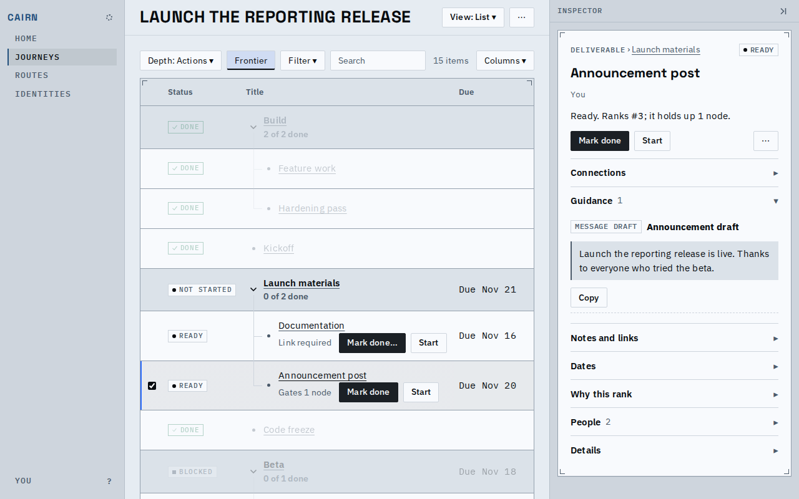
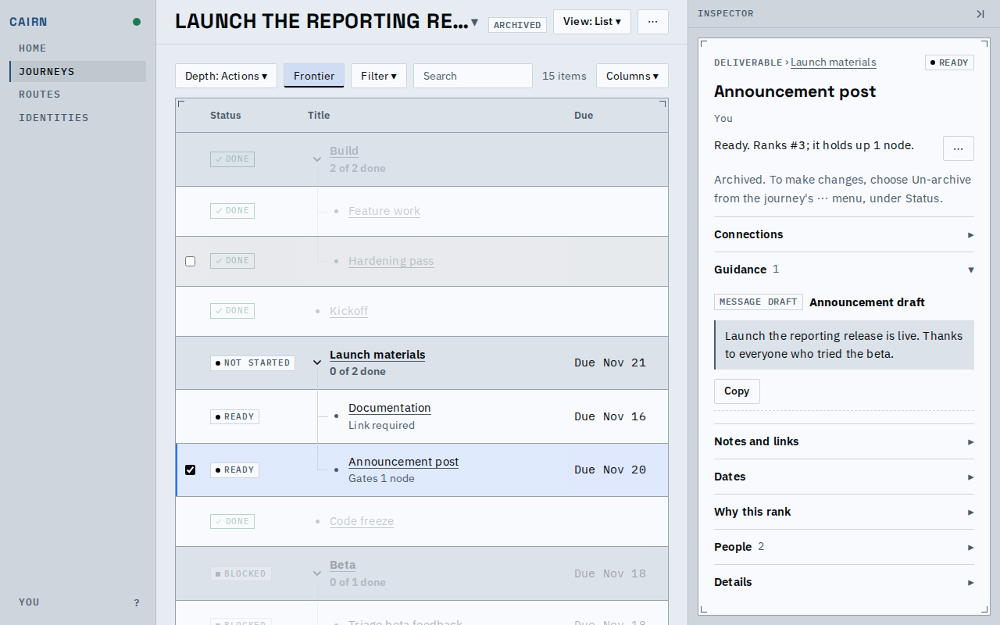
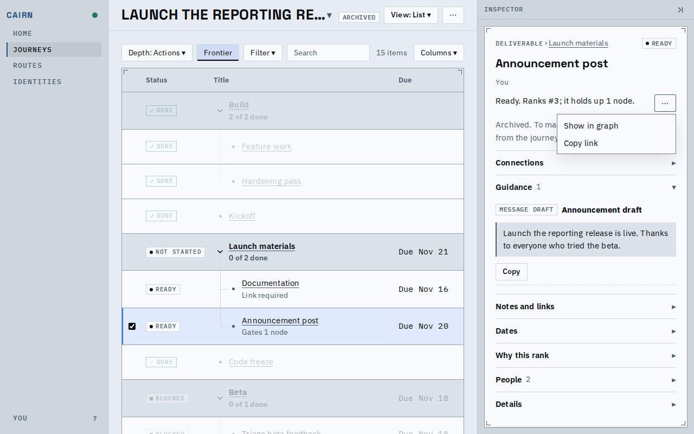
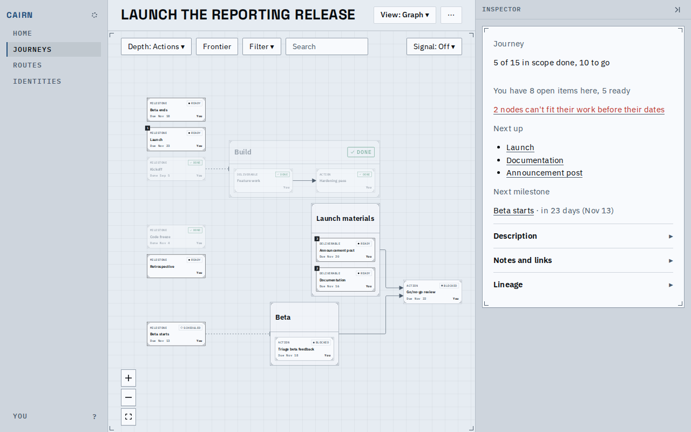
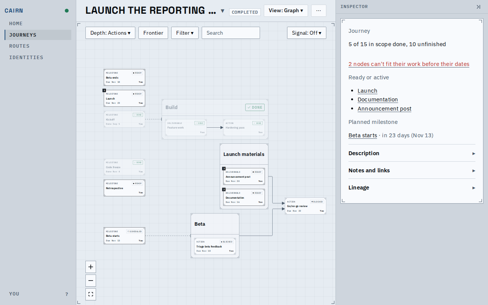
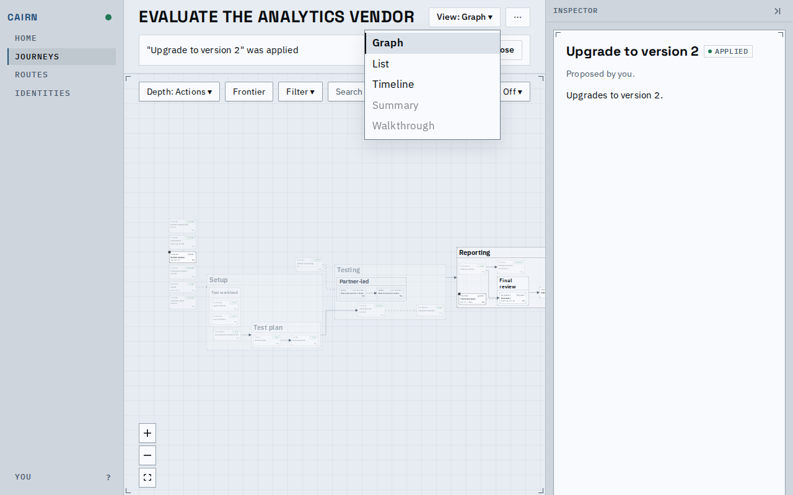
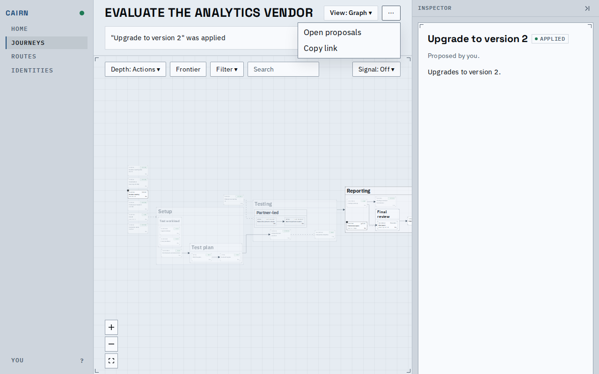

# Closed journeys and the views a page offers

An archived journey now offers no write anywhere: the node panel, the list's rows, the canvas
menu, the card and every editor drop their actions, and the node's menu keeps only where to find
it. A completed journey's card no longer says what is yours as if the work were current. A page
under a proposal, whether still in review or already applied, offers no live write and marks
Summary and the Walkthrough unavailable. The key sheet lists only the keys that act on the page.

## An archived journey takes no write

Active: Mark done and Start on the frontier rows and in the open node's panel.

Archived: the rows and the panel offer nothing to act on, and the panel says why and where
Un-archive is (the journey's menu, under Status).

The menu keeps Show in graph and Copy link; Rename, Assign, Pin and Edit node are gone.

<video src="archive.webm" controls width="640"></video>

Archiving with a node open, the menu, then moving the journey to completed brings the actions back.

## A completed journey's card

Active, then completed: the line about your open items goes, as it already did on the Summary and
in the index's Only mine, and the card says what is unfinished, what was left ready or active and
the planned milestone, in the Summary's words, at the inspector's body size. The shortfall count says what the days mean ("can't fit their work before their
dates") instead of "short of days", and the header keeps to one line, a long name ending in an
ellipsis that a click opens whole.

## Under an applied proposal

After Apply, Summary and the Walkthrough stay listed but greyed, their reason on hover. Before,
they looked live and picking one quietly opened the graph.

The journey menu offers no Edit, Insert or status move while the layer is on.

## A route's key sheet

![A route version's key sheet on the graph: Esc, v, 1 to 4, search, ] for the inspector, the sheet and the graph's f](route-keys.png)

A route has no Frontier, Only mine or Walkthrough, so Shift F, m, w and p are not listed; on the
graph there are no rows for j and k, and a version's nodes have no action for Enter. Every sheet
reads the same per-screen table, so the Summary lists no view-state keys either. `]`, which hides
and shows the inspector, is now listed.

## Known limits

- Starting a journey from a retired route is now refused by the engine, not only hidden: an
  agent that tries gets a rejection saying the route is retired.
