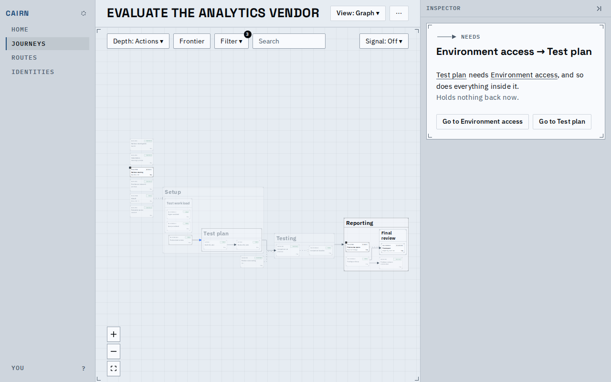
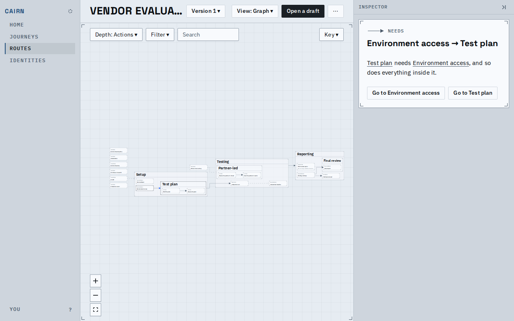
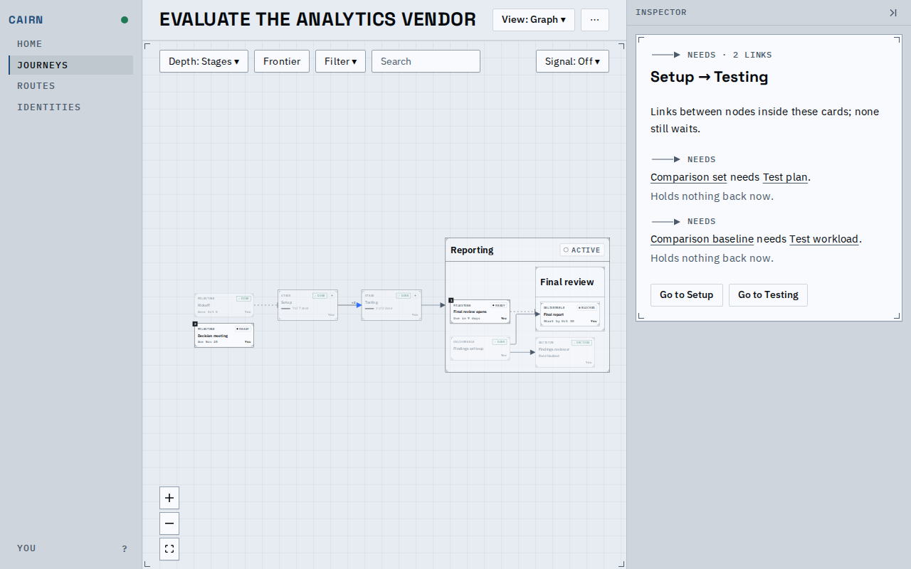
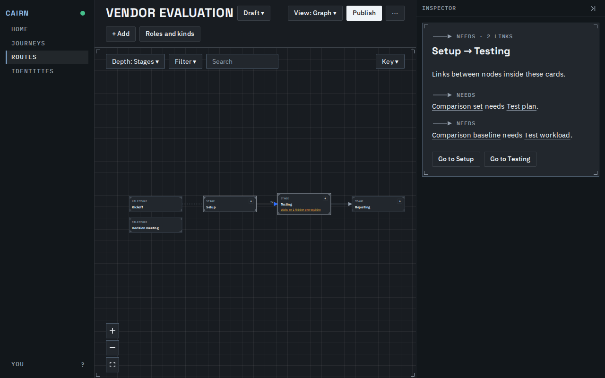
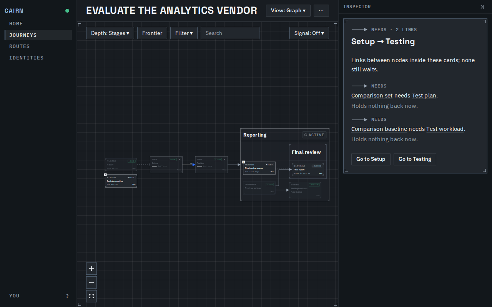
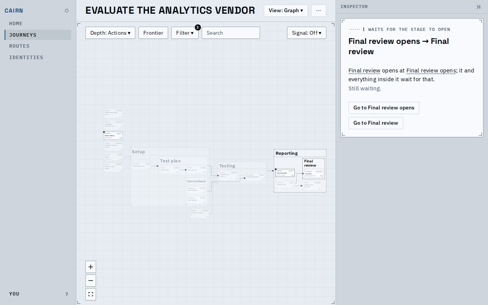
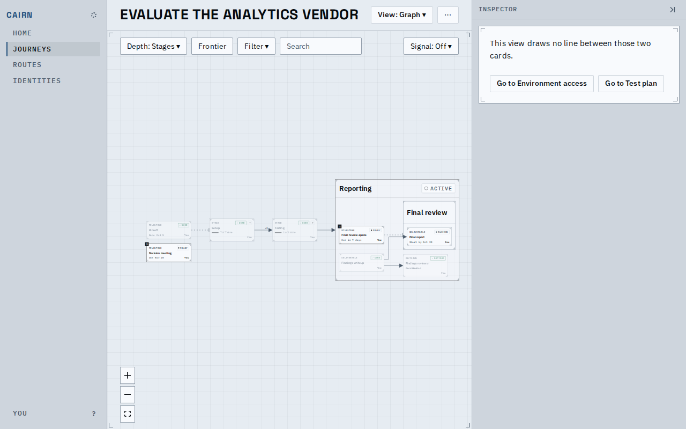
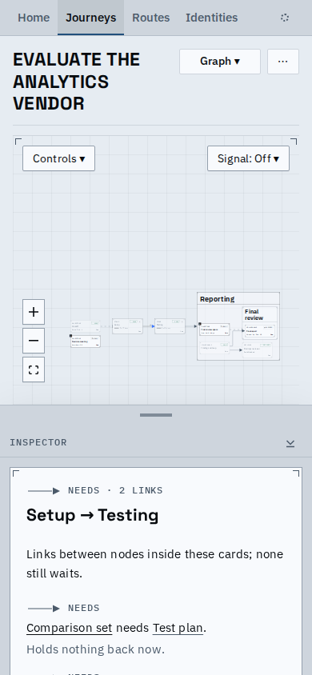
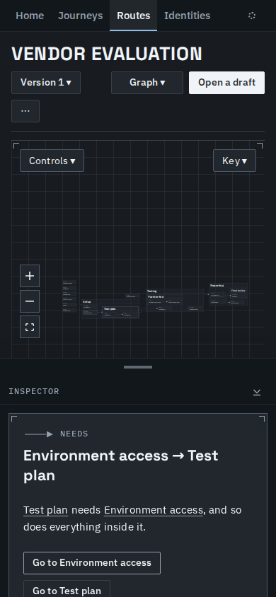
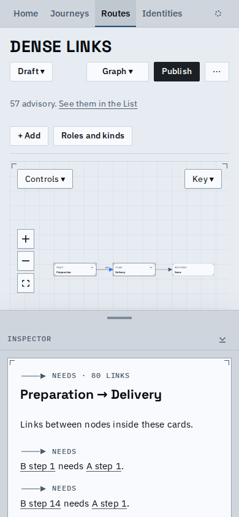

# One card for any line on a journey's or a route's graph

Clicking a line on a journey's graph or a route's graph (a draft, a published version or a
segment) opens one card that says what the line stands for. A line between folded stages used to
open "no such link"; it now lists each link inside it, strongest kind first, with both ends of each
as links and Go to for either card the line joins. On a journey each link says whether it still
waits or holds nothing back now; a route's card says nothing of state.

## A single link

A journey, Environment access to Test plan. The glyph is the Key's, both ends are links, and the
state is said on a line of its own where the journey knows it.

A published version of a route, the same line. The address keeps the version; no state.

## A line that stands for several links

At Stages the line from Setup to Testing stands for two links (one authored for this picture beside
the one the fixture has). The header gives the strongest kind and the count, each row its own kind
and ends, and the two cards the line joins are outlined.

## Other kinds and states

A stage opening, which still waits (a date-only opening says neither).

Depth changed under an open line: the card says the view draws no line and offers both ends.

## Phone width

## Selecting a line

<video src="edge-card.webm" controls width="640"></video>

On a journey at Stages: hover and click the line between the stages, read the list, follow
Comparison set; then a line on a route's version.

## Known limits

- While a node is selected, a line that only its selection draws (one inside a stage opened to show
  it, or one Reveal adds) keeps its hover and opens no card; neither does a line on a proposal's layer.
- A line standing for many links lists the first 50 and offers the rest.
