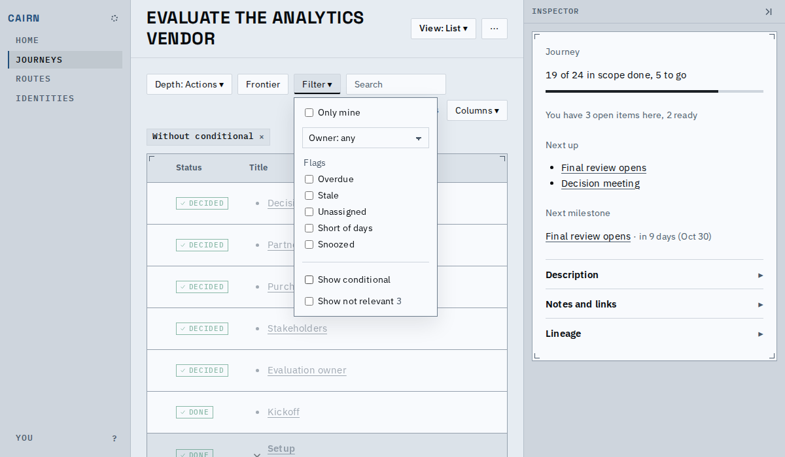
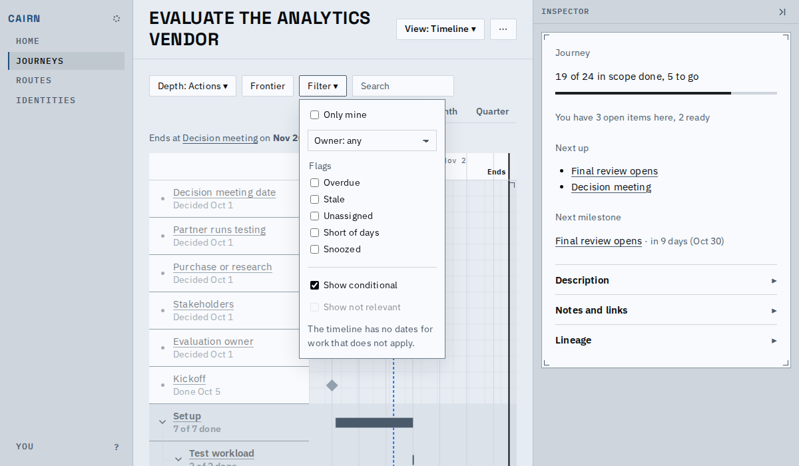
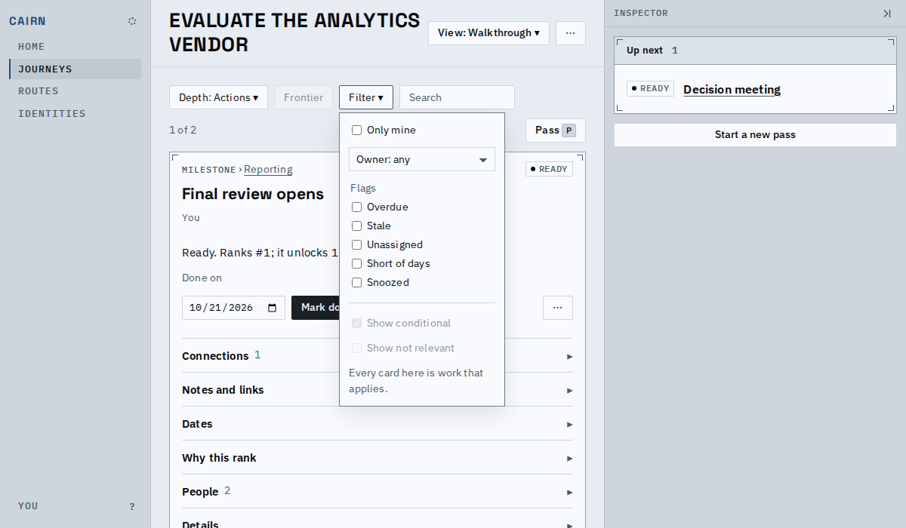
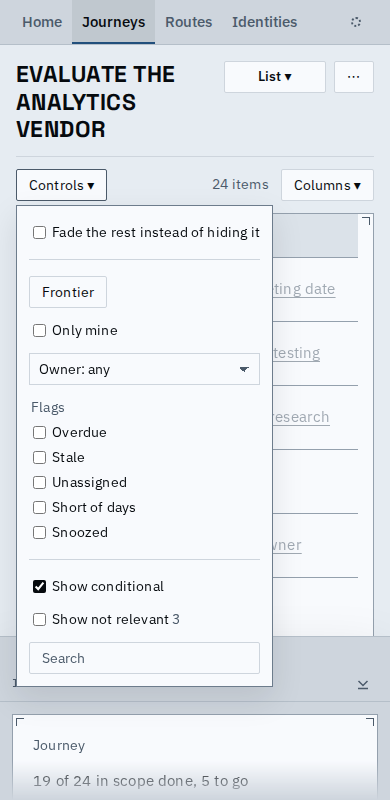

# The Filter counts what it hides, beside the box that shows it

Open the Filter and each relevance class says how many nodes it is keeping out, right beside its box: "Show not relevant 3". The toolbar's Filter button no longer wears a count badge; Depth keeps its own.

## On the list and the graph

Both classes can be drawn, so each box can show a count in muted type (this journey has three settled-out nodes and no conditional ones, so only not relevant shows one). Checking the box draws them and the count goes.

## Where a view cannot draw a class

The box stays set but disabled, with the reason under it and no count. The timeline cannot draw not-relevant work (no dates for it); the walk through draws neither class, since every card there is work that applies.

## On a phone

The Controls menu holds the same Filter, with the same counts; its own badge now counts what Depth hides alone.

## Known limits

- The count appears only while the Filter is open; a closed toolbar shows no sign that nodes are hidden.
