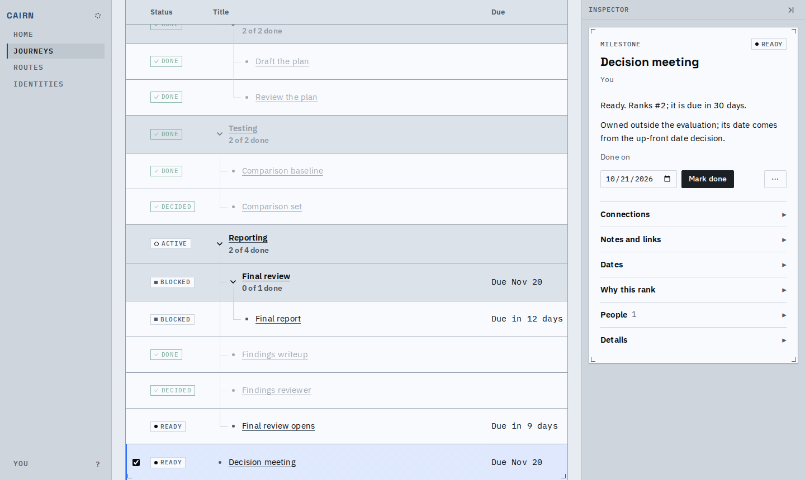
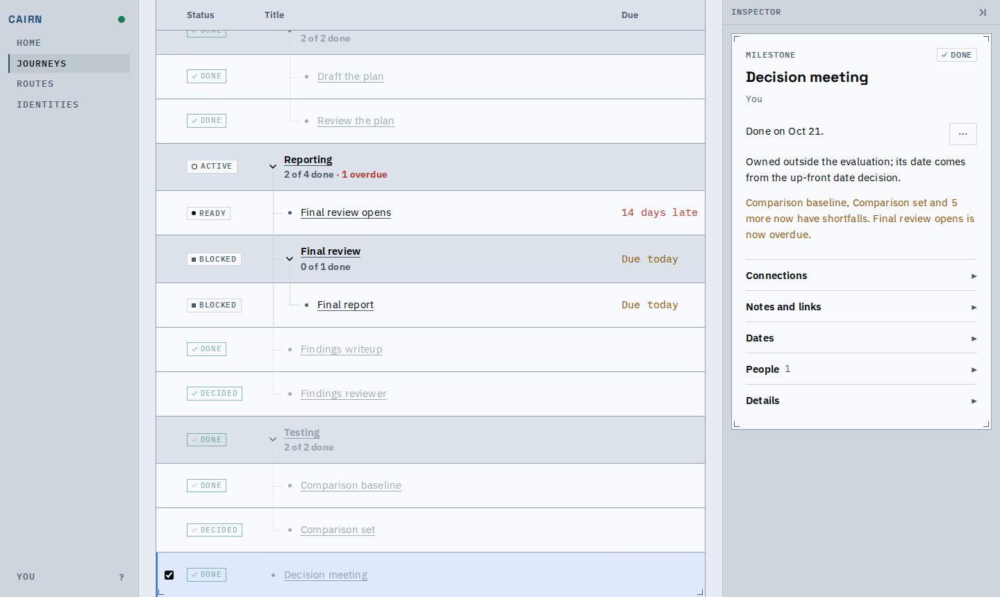
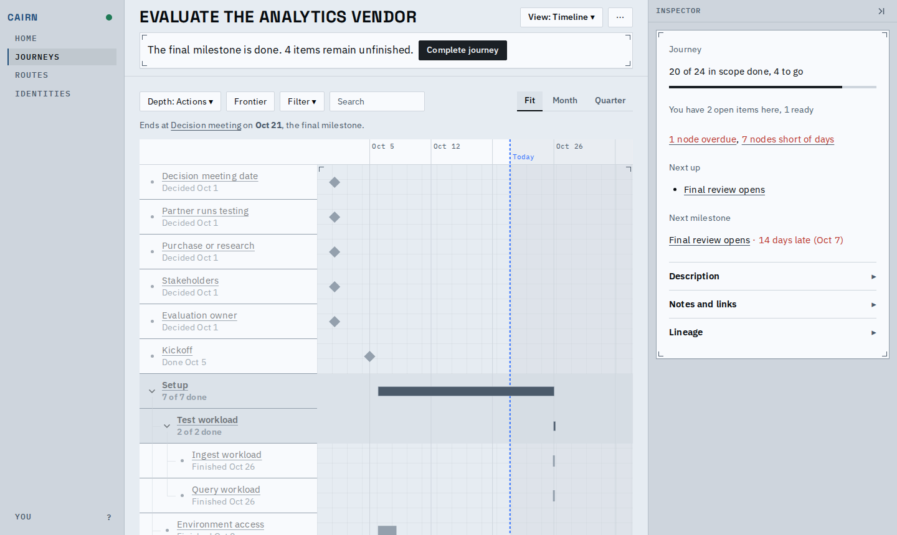
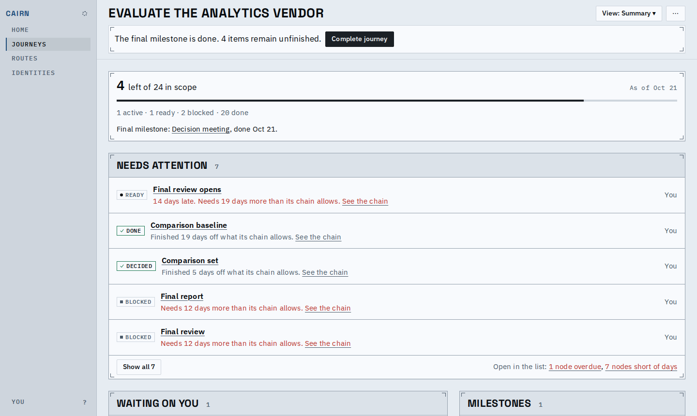
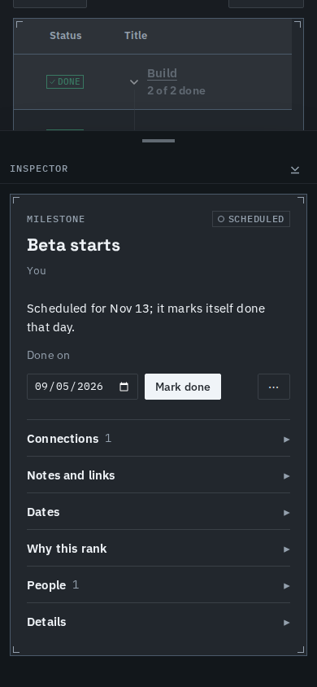
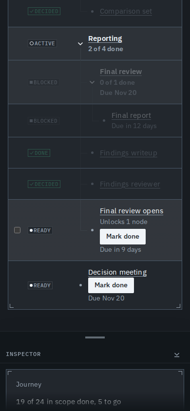
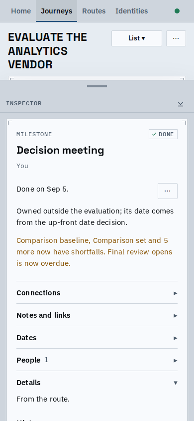
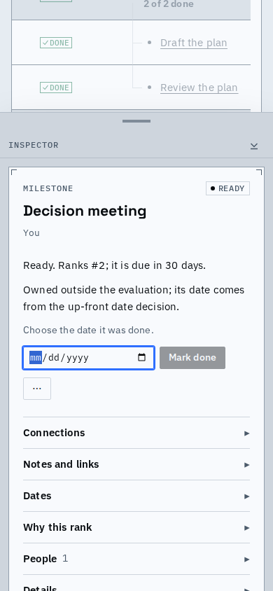
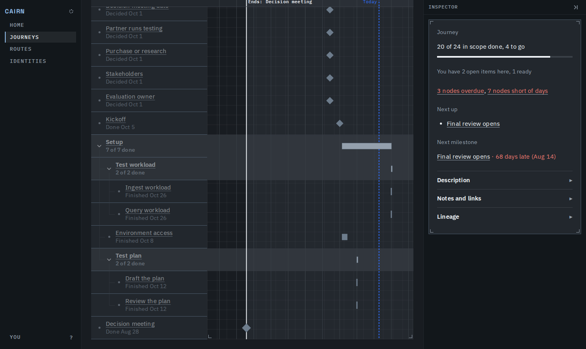

# A finished milestone is "Done"

A milestone you finish is now called done everywhere, the same word and the same button as every other step: Mark done, a Done chip, "Done on" its date, "Marked done" in its history. The setting that lets a milestone finish by itself reads "Marks itself done on its date". Journeys stored under the old words are converted when the server starts.

## One button

A milestone that is not done yet offers Mark done, with a date field for the day it was done (today unless changed). A milestone that marks itself done on its date offers the same button, not a separate one.

After the click the chip, the inspector and the list all say Done, and the date is the one given.

## The same word on every screen

The Timeline row of a finished milestone says "Done" and its date; the summary's milestone line and its recent-finish list use the same word.

## Phone and dark

The same button and date field work at phone width and in dark. A milestone that marks itself done on its date offers the one Mark done too, from its inspector (it is not on the list's frontier rows, so a row carries none).

## Known limits

- Route files exported before this change name the old setting and must be exported again.
- Earlier proofs and decision records keep the words of their day.
