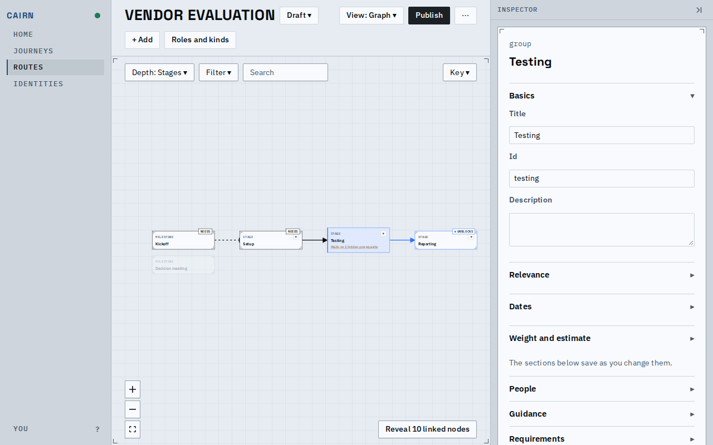
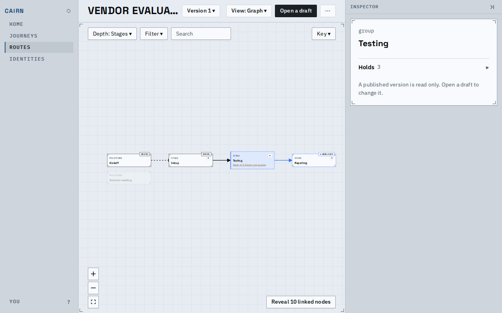
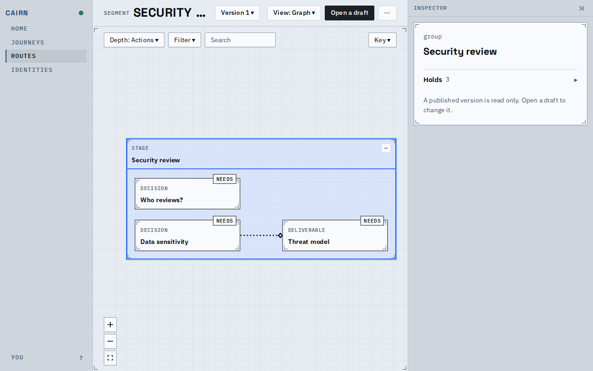
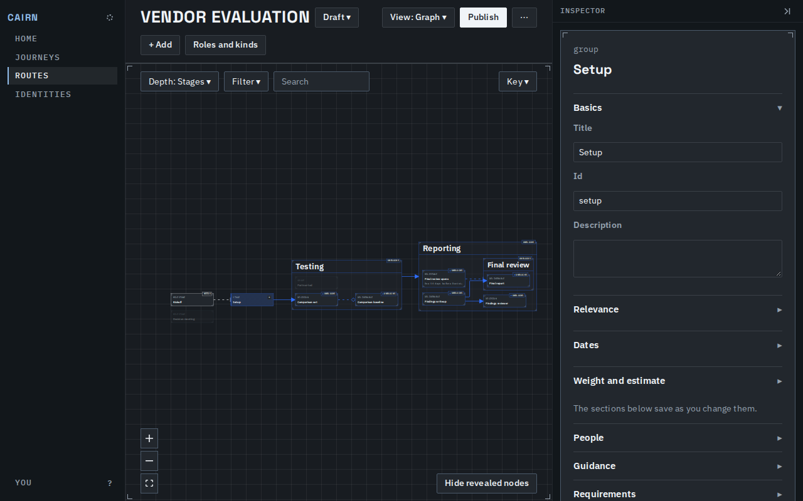
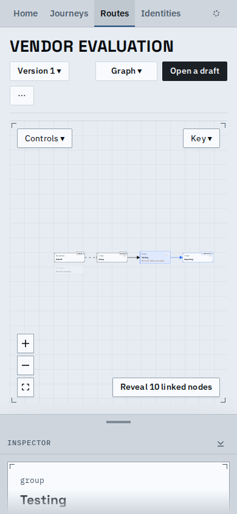
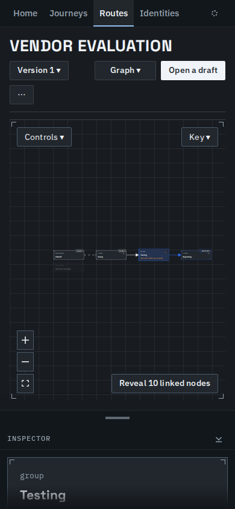
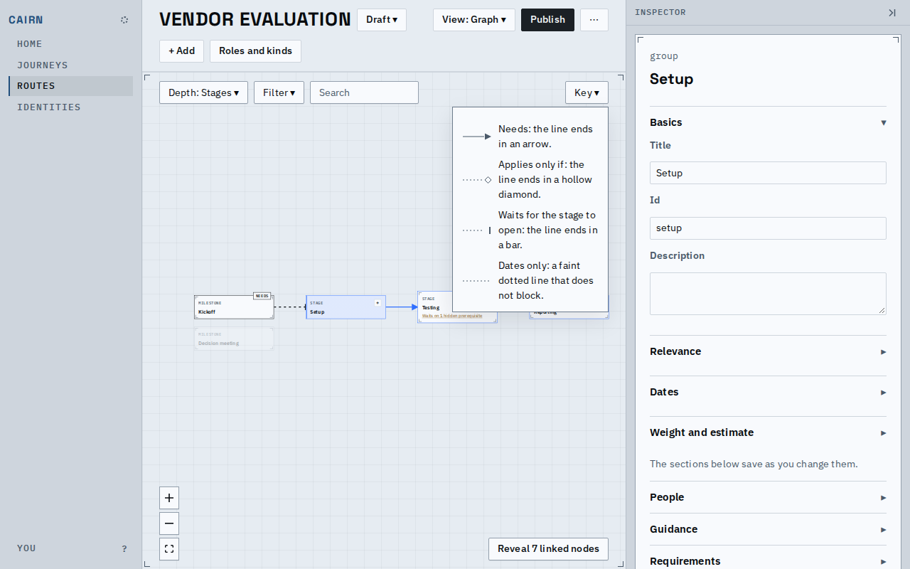

# Selecting a node on a route traces it, as on a journey

A route's draft, a published version and a segment now act like a journey's canvas when a node is
clicked: the lines that lead to it and from it light up, the cards it needs and unblocks carry a
NEEDS or UNBLOCKS tag, the other cards fade, and a card that adds to the selected node's gravity
carries a small filled dot on its tag. Both canvases share one code path; the route-only path is
gone. A version's node opens in a read-only panel, and its address keeps the version.

## The draft, a version and a segment

The draft, Testing selected at Stages depth. What it needs and unblocks is lit, the rest fades, and
"Reveal 10 linked nodes" offers the cards folded into the stages.

A published version, the same selection. The panel beside it is read only.

A segment's page, its stage selected.

## Dark, phone width and the key

Dark mode, after Reveal: the nodes behind the stages are drawn and traced, and Hide takes them off.

Phone width, light and dark: the canvas above, the inspector as a sheet below.

The Key button, where a journey's canvas has the Signals lens, opens the key to the lines.

## Selecting and deselecting

<video src="route-trace.webm" controls width="640"></video>

On a draft: select a node, go to Stages, select a stage, Reveal and Hide, click the empty canvas to
clear it, then pick version 1.

## Known limits

- Edge selection and the edge card, the Signals lens, selecting several nodes and the node menu
  stay a journey's; the reasons are in the decision record for this change.
- At phone width the whole route is drawn small until it is zoomed.
