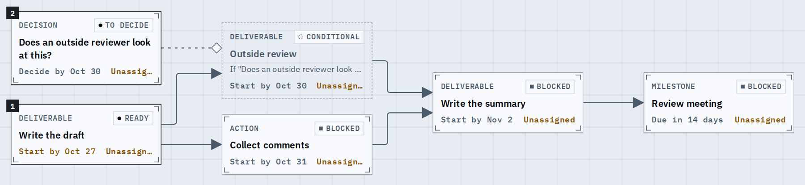
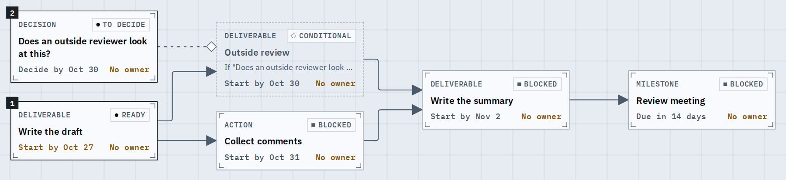
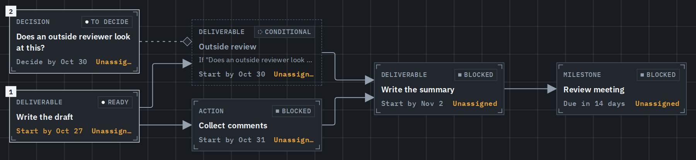
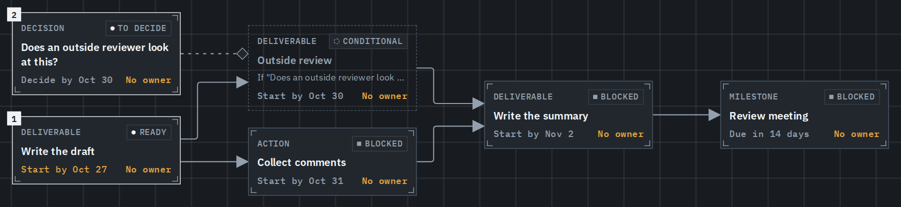
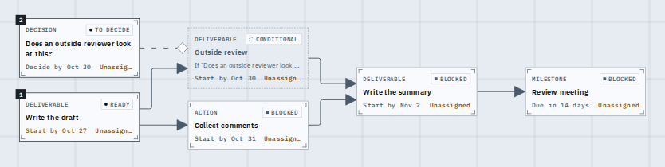
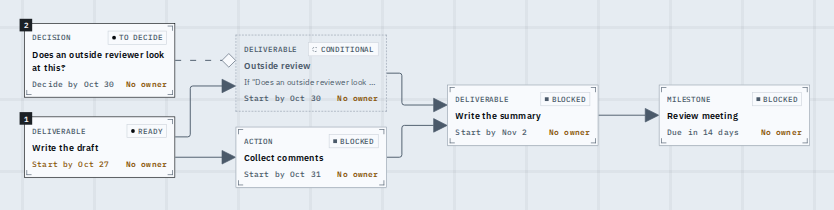
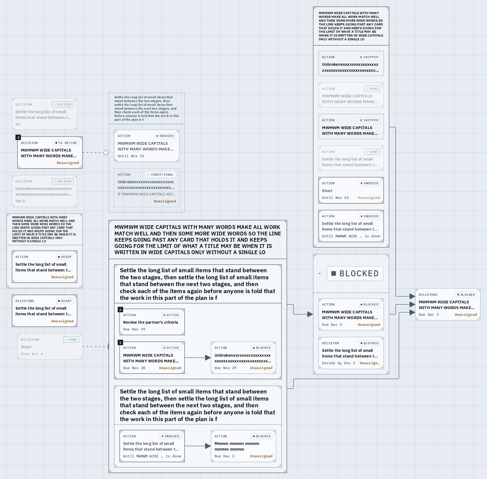
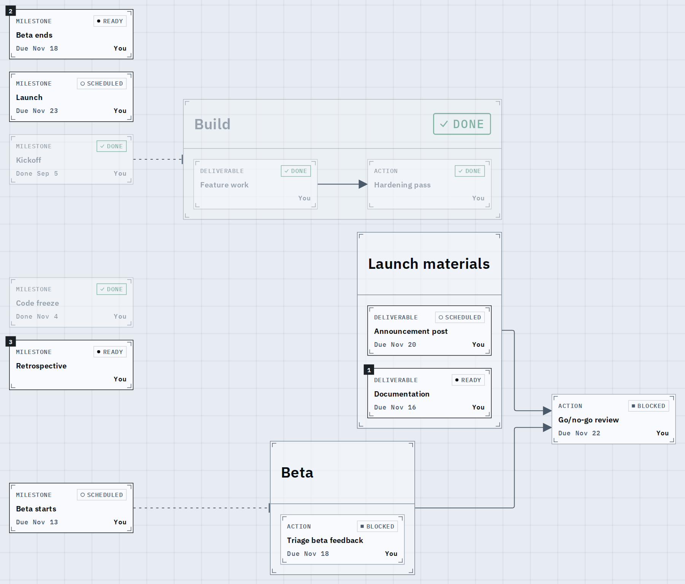

# Card footers read whole

A graph card's foot line now says its date and its owner in full on every card. Before, the owner's word was cut ("Unassign...") whenever the date beside it was a long one such as "Start by Oct 30", and beside a long snooze target it dropped out. The shots are the cards at reading size, cropped from the graph.

What changed: a node nobody owns reads "No owner" (8 letters, not 10), the owner sits at the foot's right edge and never shrinks, and when a date and the owner cannot both fit, the date takes the ellipsis. The inspector and the title's hover still say "Unassigned".

## The practice journey, desktop

Before: every card's owner is cut.

After: date and owner both whole.

Dark theme, before and after (the layout is the same; only the tokens differ).

## Phone

Before.

After.

## The stress journey (the longest titles and snooze targets the limits allow)

Before: the owner is squeezed out beside a long date.

After: the owner stays whole; a long snooze target ends in an ellipsis with its tail kept.

## A journey whose owner is the viewer

Unchanged: "You" already fit (before, then after).

## Known limits

- The stress journey fitted to a phone draws its cards too small to read, so its phone footers are not shown; the same cards are 240px wide at every size, and the browser test checks every owner is whole.
- A very long snooze target still ends in an ellipsis; its words are on the card's hover and in the inspector.
