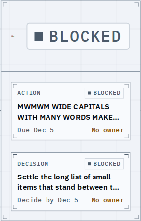
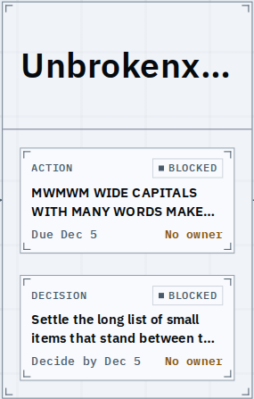
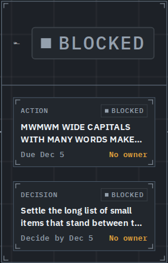
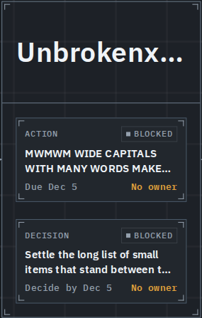
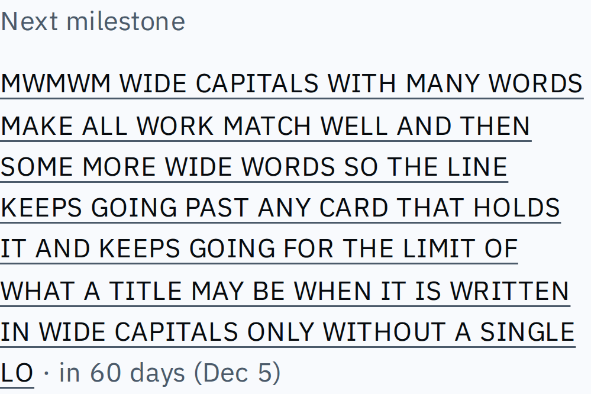
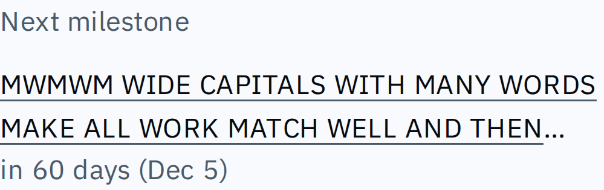

# A stage keeps its title, and the next milestone stays in its box

Two long-content cases now hold up. A zoomed-out stage whose title is one very long word shows a readable start of that word and an ellipsis instead of a huge state chip and a speck of title. The journey overview's next milestone is cut to two lines with an ellipsis (its full title on hover) and its date (with where it comes from on hover) reads right under it, as the other lists' titles do.

## A zoomed-out stage with one very long word for a title

Before: the chip takes the whole head.

After: the title keeps the room at the reading size and the chip goes.

Dark, before and after.

## The overview's next milestone, with the longest title a node may have

Before: a paragraph of capitals with the date trailing at its end.

After: two lines and an ellipsis, the date beneath.

## Known limits

- The stage's whole title is in the inspector; a one-word title wider than the head is only ever a prefix on the graph.
