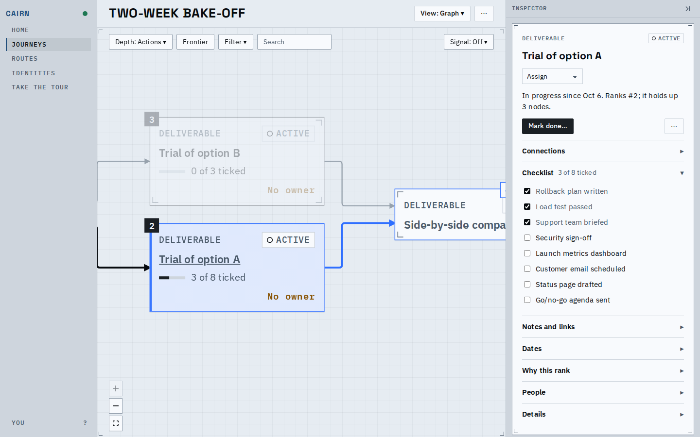
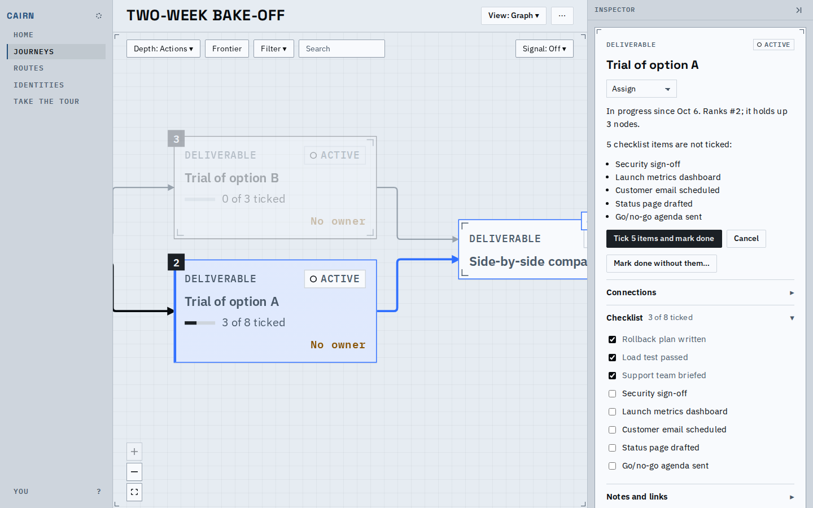
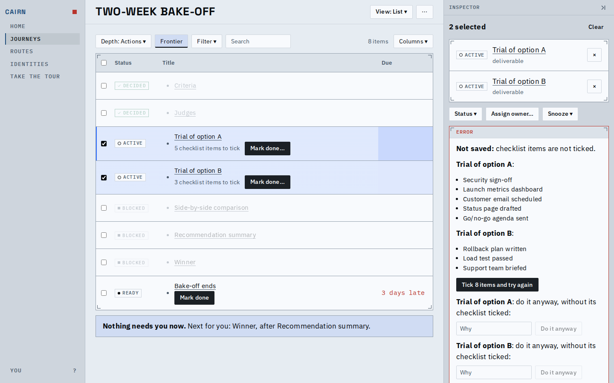
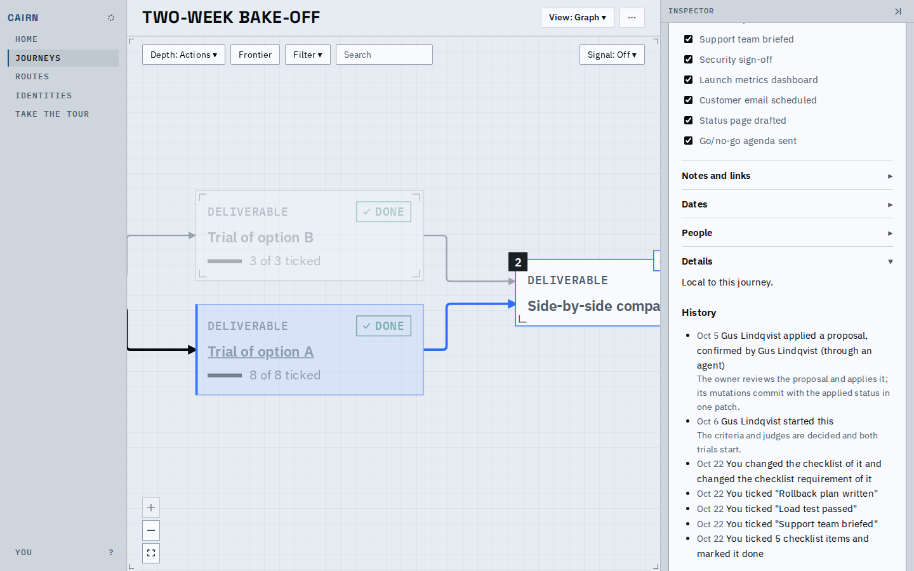
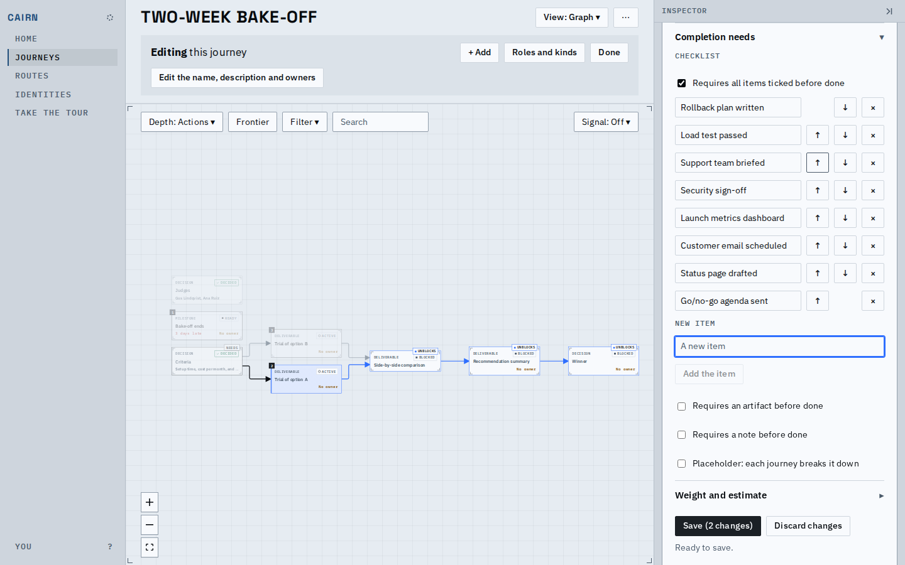
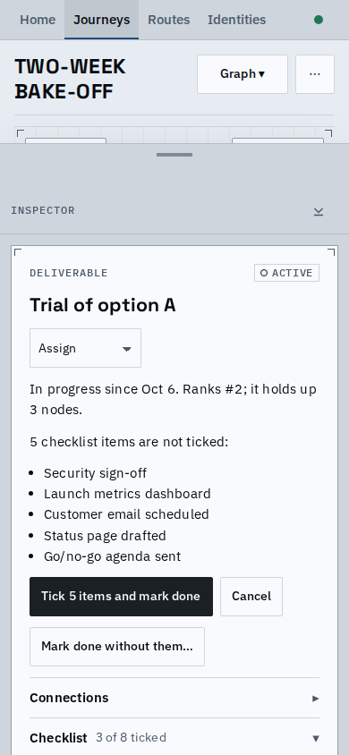
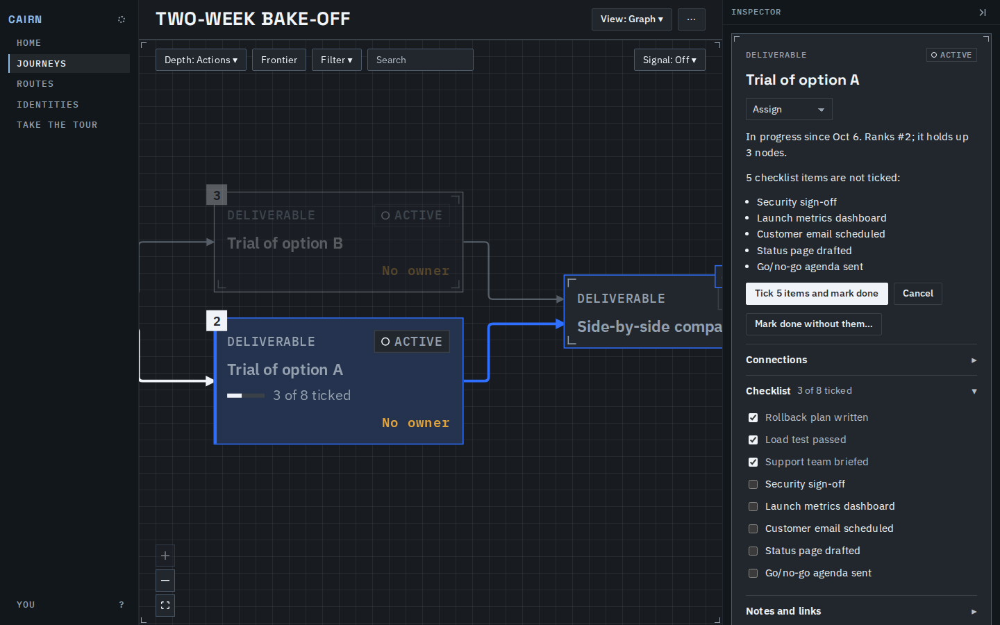

# Proof: checklists in the web app

A person can now author a checklist on a node, tick its items in place, finish the node with
one patch that ticks the rest, and see the progress on the card.

## Ticking in place

The Checklist section on a node: each item is a box that writes on its own and shows its own
refusal.

Mark done on a node with unticked items lists them and offers "Tick N items and mark done":
the ticks and the completion go in one patch.

When a node is completed some other way, the refusal names each unticked item, offers to tick
them and try again, and offers "Do it anyway" with a reason.

After the work, the history says which items were ticked, and the card shows "N of M ticked".

## Authoring

Items are added, reordered with the arrow buttons, and removed in the node form; a flag says
whether every item must be ticked before the node can be done. Removing an item says its tick
goes with it.

## Phone and dark

Rows and editor buttons take the 44px touch target on a coarse pointer.

## The main flow

<video src="flow.webm" controls width="640"></video>

## Before and after

| | Before | After |
|---|---|---|
| Items on a node | listed as read-only rows | boxes that tick and untick in place |
| Done with unticked items | refused with no way forward but a bypass | one button ticks the rest and completes |
| Card | no progress | "N of M ticked" line |
| Route editor | no checklist field | items, order, and the require flag |

## Known limits

- Lists and the summary show only "N checklist items to tick" for a node, not the items.
- Pressing Save with a typed but not yet added item adds it first; a second press saves.
