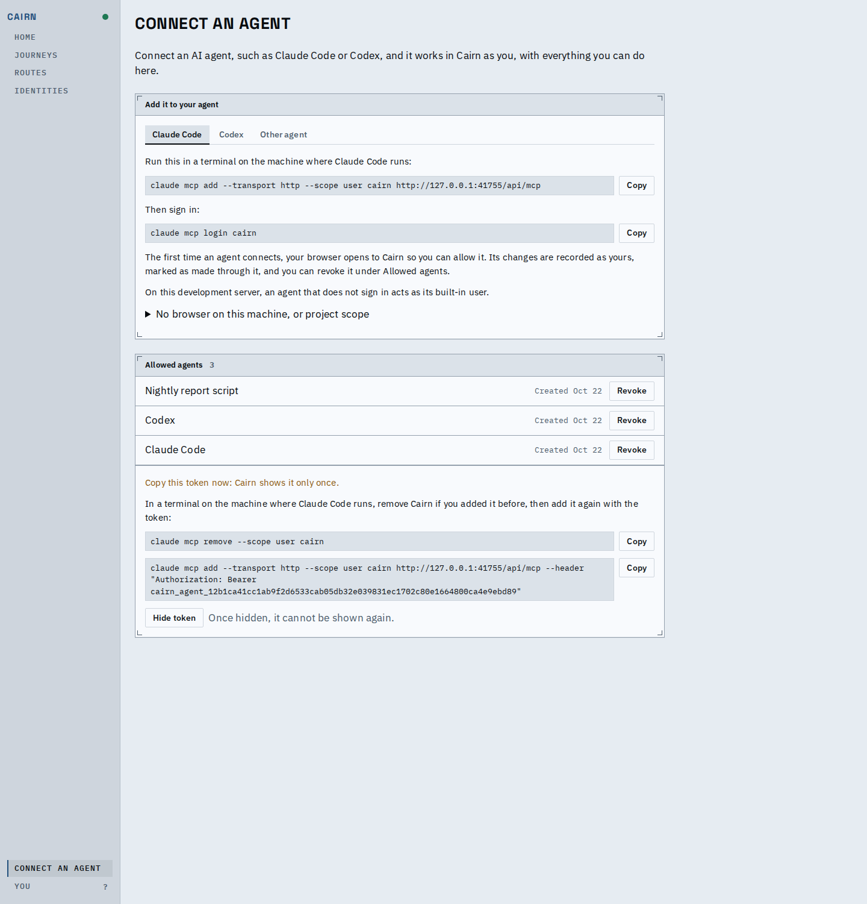
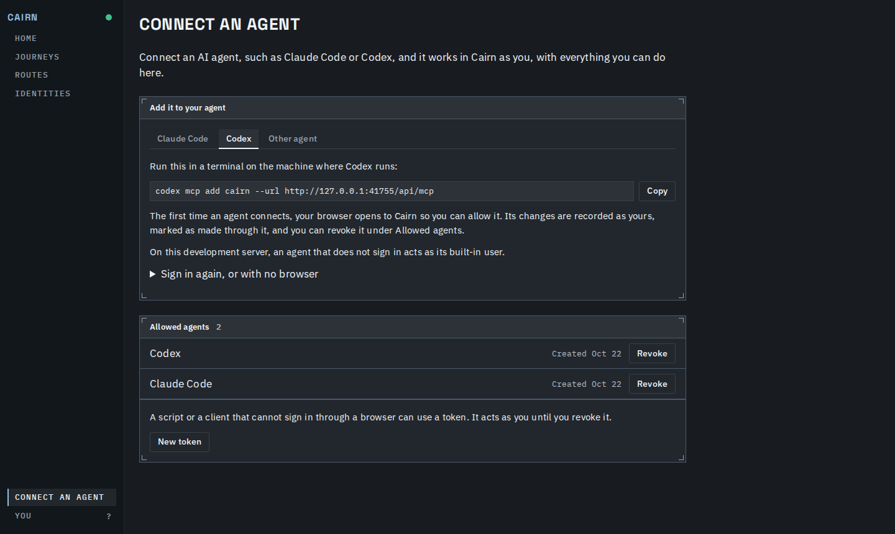
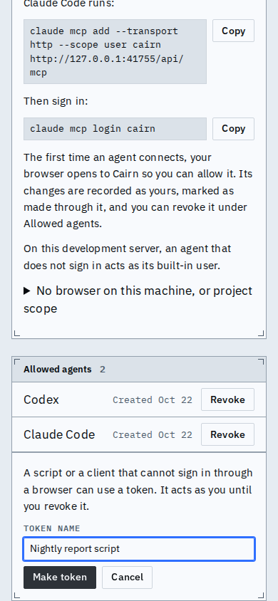
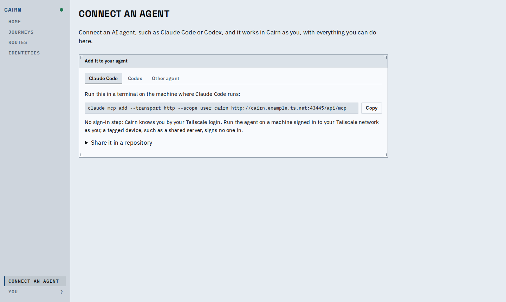
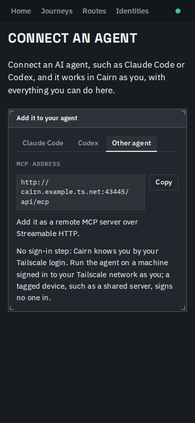
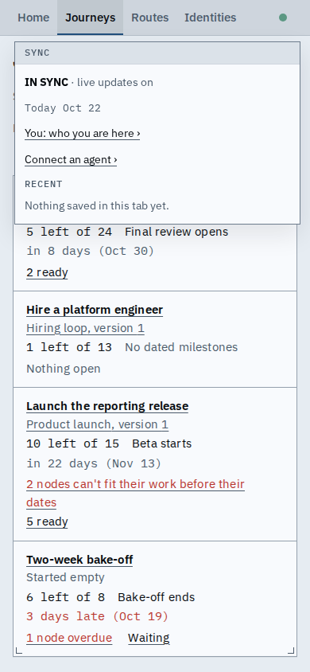

# Connect an agent

A person can open **Connect an agent** from the rail, pick Claude Code, Codex or another client,
and paste the one command for it, worded for the sign-in their Cairn has.
Where the Cairn accepts agent tokens, the same page lists the agents they allowed and the tokens
they made, revokes them, and makes a new token for a script. The first two setups are real
servers: the built-in sign-in is `cairn demo`, and the tailnet one is a server behind a trusted
Tailscale proxy.

A token just made: shown once, with its one-time warning and the command for the client picked above.

Dark theme, Codex picked: its command, then what signing in is like here.

On a phone the commands wrap inside their boxes, Copy stays beside each, and the form fits.

Behind Tailscale there is no login command and no tokens panel.

Other agent holds the address itself to copy, and what a client needs.

A phone's top bar keeps its four screens; Connect an agent is a link in the sync popover, beside You.

<video src="connect-an-agent.webm" controls width="720"></video>

The main flow: open it from the rail, copy the command, switch client and copy the address, make
a token, copy its command, hide it, revoke it.

## Known limits

- The commands were checked against the clients' own help and run against a scratch server; a
  client that changes its flags changes the text.
- A hosted connector works only where the address is reachable from the internet, which Cairn
  cannot know.
- An agent connected through Tailscale or IAP is recorded as the person alone.
