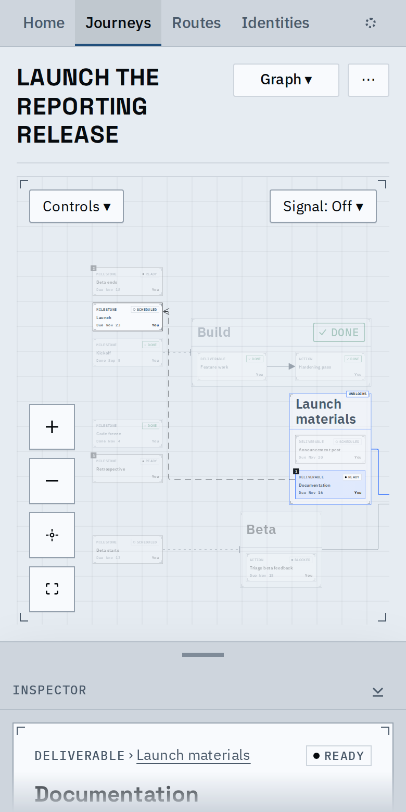

# Date lines: a node's date relationships, drawn when it is selected

Select a node and its date relationships appear beside what it waits on: the due-by and not-before rules it has or that read it, its stage's close and opening, and a date decision that sets a milestone. They are dashed ink lines, never faded, with an open arrowhead at the later end only where the order is fixed. They have no text; hover gives the sentence. The inspector's Linked dates section (with its count) lists the same relationships, each with the other node as a link.

At rest: no date lines and the layout is the one dependencies and stage structure give. Date lines are drawn only for a selection.

Documentation is due 7 days before Launch: one line, arrowhead at Launch, the sentence on hover.

Launch has five relationships. The far ends and the frames around them stay in full ink while the trace fades the rest; the arrowheads on Launch's right side take places of their own. Linked dates lists the other node first, its sentence beneath.

Beta starts: a not-before after the code freeze (arrowhead) and a due-after tied to Beta ends (no arrowhead, since it fixes no order), each at a port of its own.

At phone width the line is drawn over a small canvas.

The new Frame button zooms to the selected card and the far ends of its dates.

Video of the main flow: [date-lines.webm](date-lines.webm) selects Documentation, hovers its line, selects Launch, opens Linked dates and follows a link.

## Ports, routes and cost

Lines meeting at one side of a card take evenly spaced places down it and run through the gutters between cards and stage frames. On the fixtures with every card selected in turn (30 lines):

| | Before | Now |
|---|---|---|
| Lines crossing a card | 5 | 0 |
| Lines crossing a stage frame holding neither end | 6 | 0 |

The layout does not read date order: feeding it made the launch fit view 0.16 against 0.45 without (the decision record has the table). A selection costs at most 3.5 ms of main-thread time on the fixtures and 11-17 ms in a synthetic case that exhausts the routing budget (one frame is 16.7 ms); routes are computed when the selection or layout changes, not on each render.

## Known limits

- A date line to a node with no card at the current depth is not drawn; the inspector still lists it.
- A due-by line can run right to left; it reads by its arrowhead and its sentence.
- A canvas too large for the routing grid, lines past the first 60, or a spent search budget draw a plain elbow that may cross cards.
