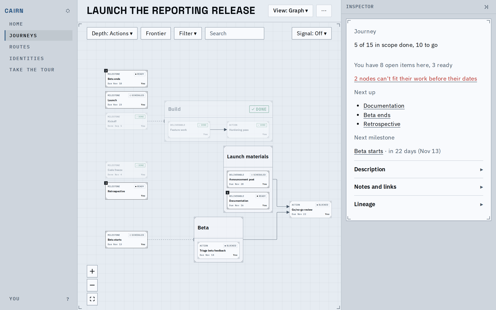
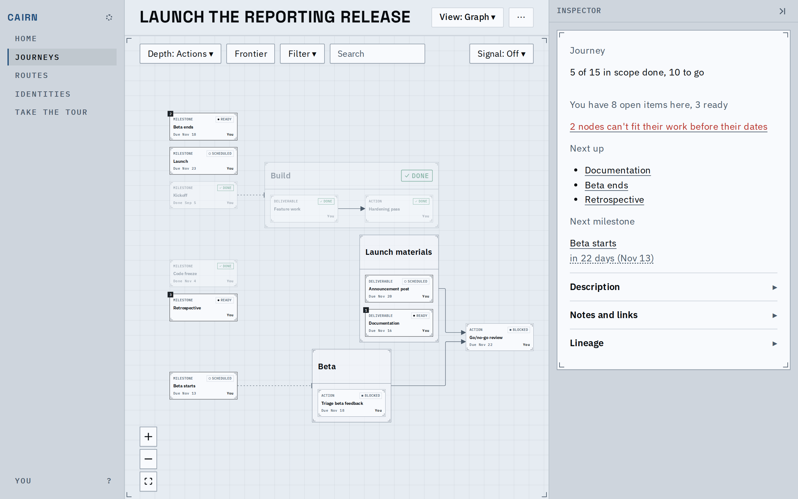
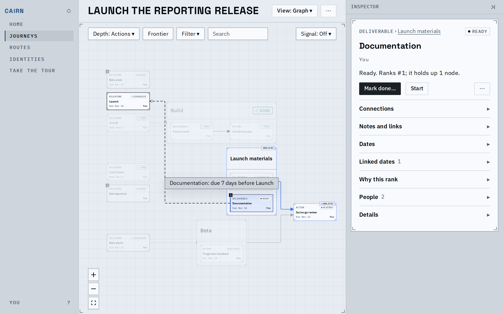
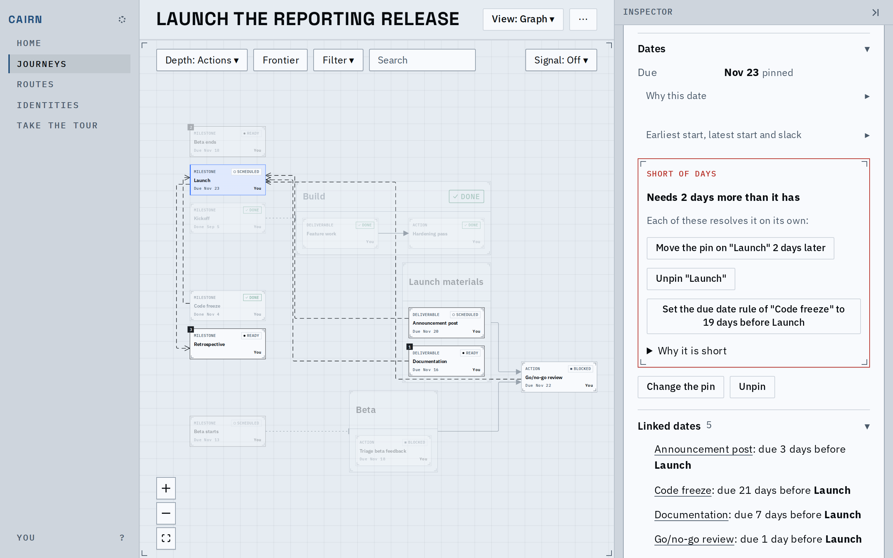
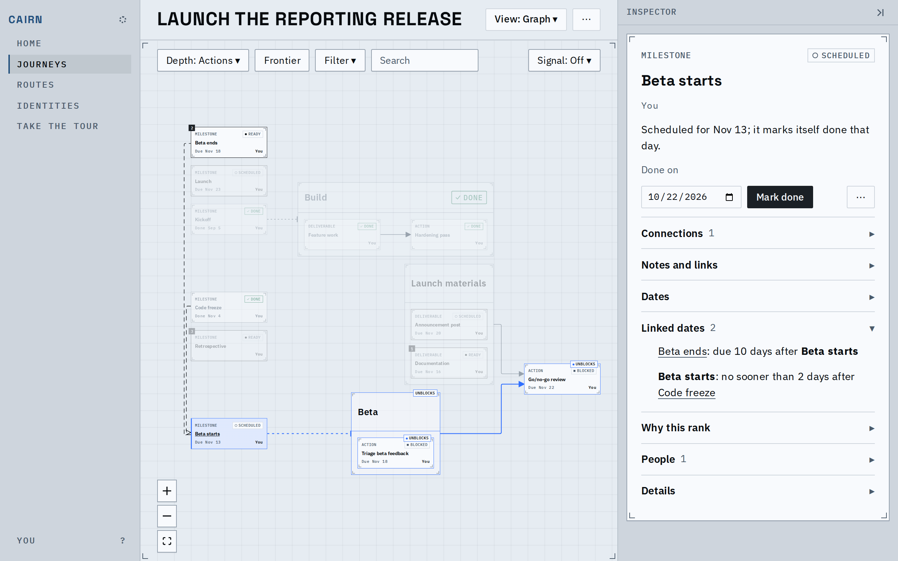
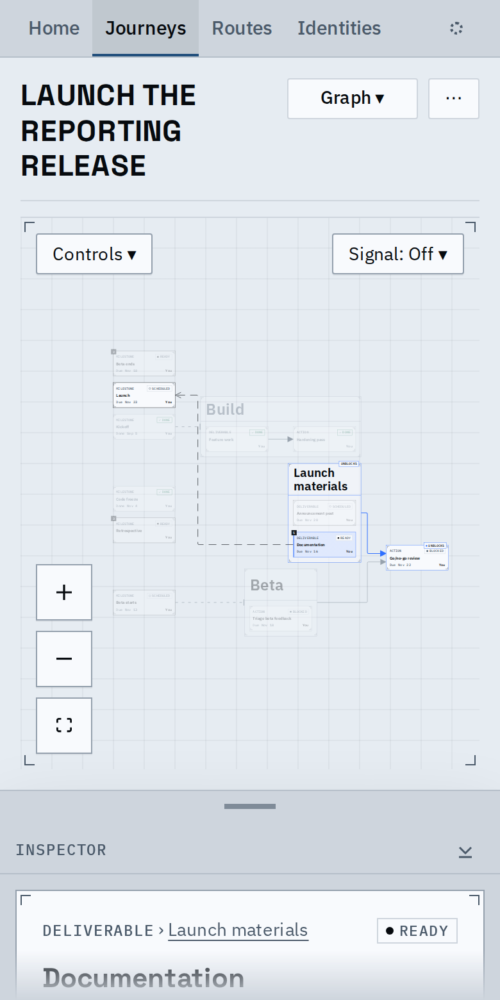

# Date lines: a node's date relationships, drawn when it is selected

Select a node and its date relationships appear beside what it waits on: the due-by and not-before rules it has or that read it, its stage's close and opening, and a date decision that sets a milestone. They are dashed ink lines, never faded, with an open arrowhead at the later end only where the order is fixed. They have no text; hover gives the sentence. The inspector's Linked dates section (with its count) lists the same relationships, each with the other node as a link.

Before: at rest on main. Nothing shows a node's date relationships.

After, at rest: unchanged. Date lines are never drawn without a selection.

Documentation is due 7 days before Launch: one line, arrowhead at Launch, the sentence on hover.

Launch has five relationships; the far ends stay in focus while the trace fades the rest, and the inspector lists them.

Beta starts: a not-before after the code freeze (arrowhead) and a due-after tied to Beta ends (no arrowhead, since it fixes no order), their lines sharing a column.

At phone width the same line is drawn over the canvas.

Video of the main flow: [date-lines.webm](date-lines.webm) selects Documentation, hovers its line, selects Launch, opens Linked dates and follows a link.

## Layout feed, measured and dropped

Feeding the ordering lines to the layout (filtered against the dependencies) was prototyped.

| Fixture | Ordering lines drawn right to left, without the feed | With it |
|---|---|---|
| launch | 8 of 9 | 0 |
| vendor evaluation | 2 of 2 | 0 |
| hiring loop, bake-off | 0 | 0 |
| stress journey | 1 of 1 | 0 |

It needs every ordering relationship in the level whatever is selected. At the node limit that is 252,097 pairs: a 45 MB level against 5.3 MB of edges, and the model build ran out of memory. So the level now carries the relationships around the selected card only, and the layout does not read them (see the decision record).

## Known limits

- A date line to a node with no card at the current depth is not drawn; the inspector still lists it.
- Lines take their own lanes and keep clear of cards where a clear channel exists; with none they cross a stage frame (Go/no-go review above). Several relationships between the same two cards share one line.
- Lines can run right to left, as the order the dates imply is not fed to the layout.
