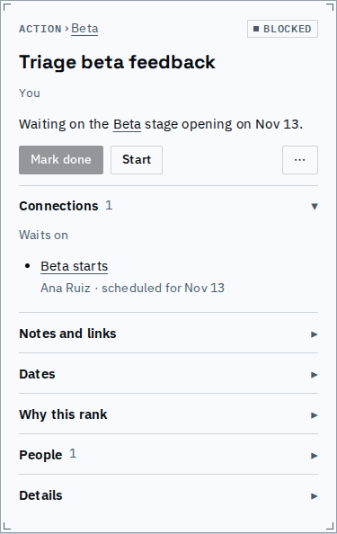
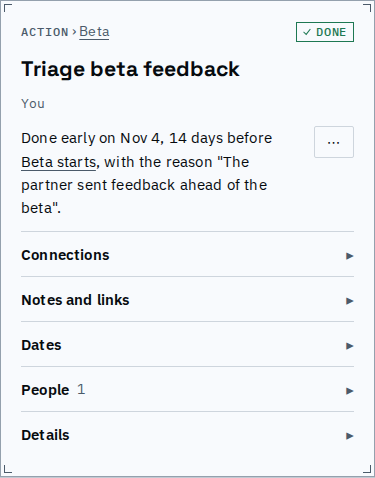
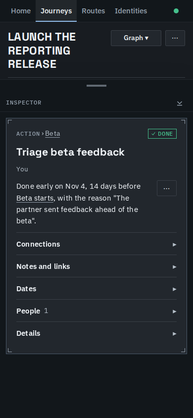

# Done early

Work finished early on purpose reads done early, not short. A person who completes a step
ahead of what it waits on, and says why, sees one plain sentence on that step, and the
prerequisites and stages around it are no longer told the plan cannot be met.

## Finishing the feedback triage ahead of what it waits on

The practice launch journey on 4 November: triaging beta feedback waits on the Beta stage
opening, a milestone that marks itself done on its date. Marking it done anyway, with a
reason:

*The step before: blocked, waiting on the Beta stage opening.*

*After: it is done early, names the milestone it was finished ahead of, and quotes the reason.*

*The same sentence in the inspector sheet on a phone, dark theme.*

<video src="flow.webm" controls width="640"></video>

*The flow: open the step, choose Done anyway, give the reason, send.*

## Before and after

Real values from the journey above, derived on 4 November (days short at a node):

| node | before | after |
|---|---|---|
| Triage beta feedback | 2 days short | not short; done early, 14 days ahead of 18 Nov |
| Beta starts | 2 days short | not short |
| Launch | 2 days short | 2 days short (unrelated, unchanged) |

A stage that does not wait for its opening milestone (opening pinned to 11 October), with
its one action completed on 6 October:

| node | before | after |
|---|---|---|
| Prep (the action) | 5 days short | not short; done early, 5 days ahead of 11 Oct |
| Opens (the milestone) | 5 days short | not short |

Everything else still holds: a dependent finished normally whose prerequisite is reopened and
finished later is still a shortfall, and a bypass for one dependency never excuses another.
Work that was started early is no longer short either.

## Known limits

- The sentence gives a day count only when the thing it was done ahead of has a date; an
  unfinished prerequisite is named, since its date moves with today.
