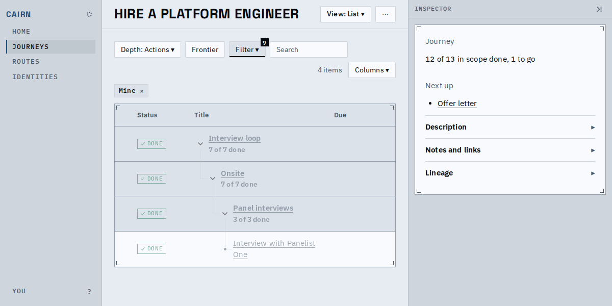
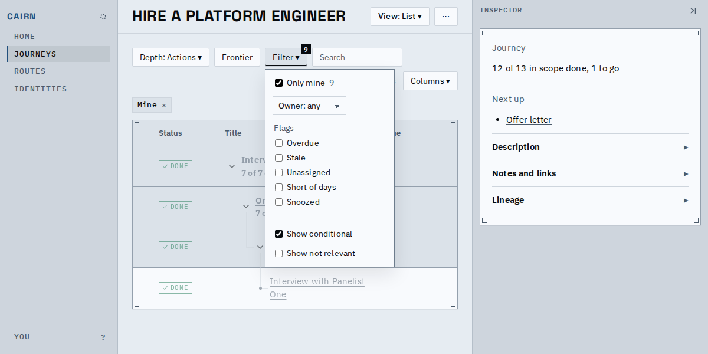
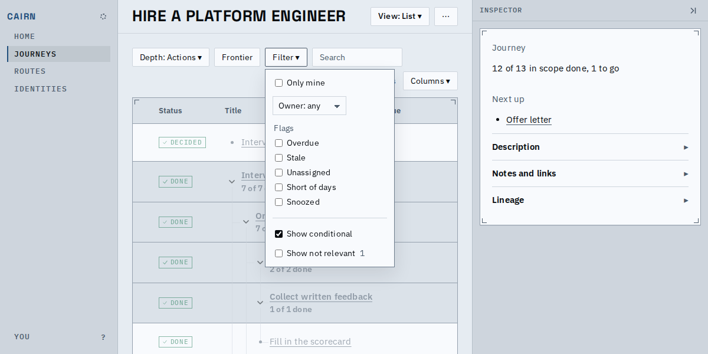
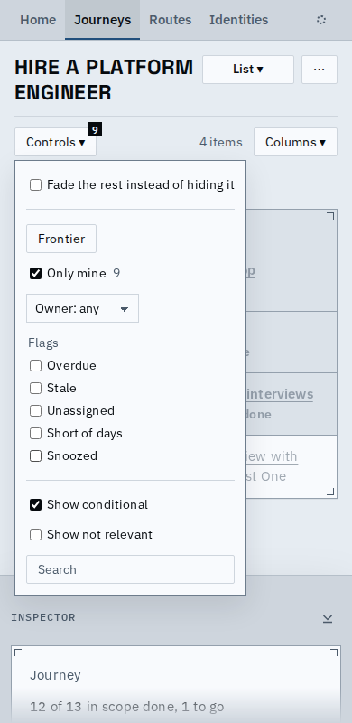
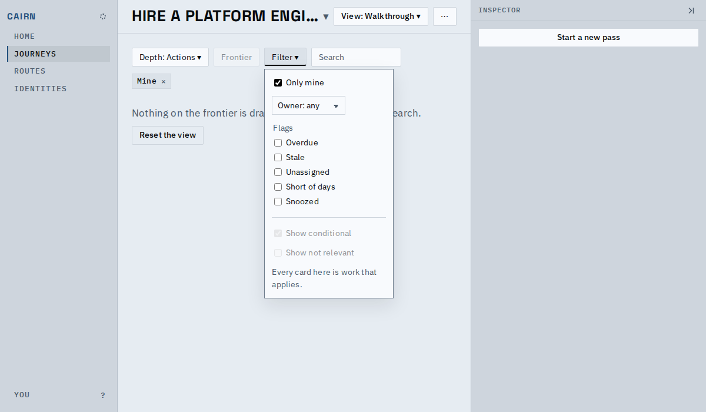

# The Filter wears a count of what it hides, and each setting counts its own

The toolbar's Filter button shows a small badge with the number of nodes its settings are hiding, and the open Filter shows, beside each setting that hides something, how many that setting hides. Nodes ruled out as not relevant never count: they are hidden by default and would be noise on every journey.

## The toolbar

With Only mine on, nine of the journey's thirteen nodes are off the list, and the Filter says 9. Depth keeps its own badge, so the two never mix on a desktop.

## Inside the Filter

Each setting that hides something carries its own count in muted type: Only mine 9. Show not relevant keeps its own count beside it when there is something to show, but that count stays out of the toolbar's badge. Owner and each flag do the same.

With nothing hidden by a setting there is no badge, and the not relevant stay out of it: the stock Filter has a count beside Show not relevant and none on the toolbar.

## On a phone

The Controls button carries the same count, added to Depth's when Depth hides something too, and its open menu shows the per-setting counts.

## On the walk through

Its cards are the frontier's, not the level's, so the level's counts do not describe them: it shows no badge and no per-setting counts.

## Known limits

- A count is what that setting hides on its own among the nodes the search keeps; two settings can hide the same node, so their counts can add up to more than the badge.
- The badge reads 9+ from ten nodes up; the exact figure is beside the setting in the open Filter.
