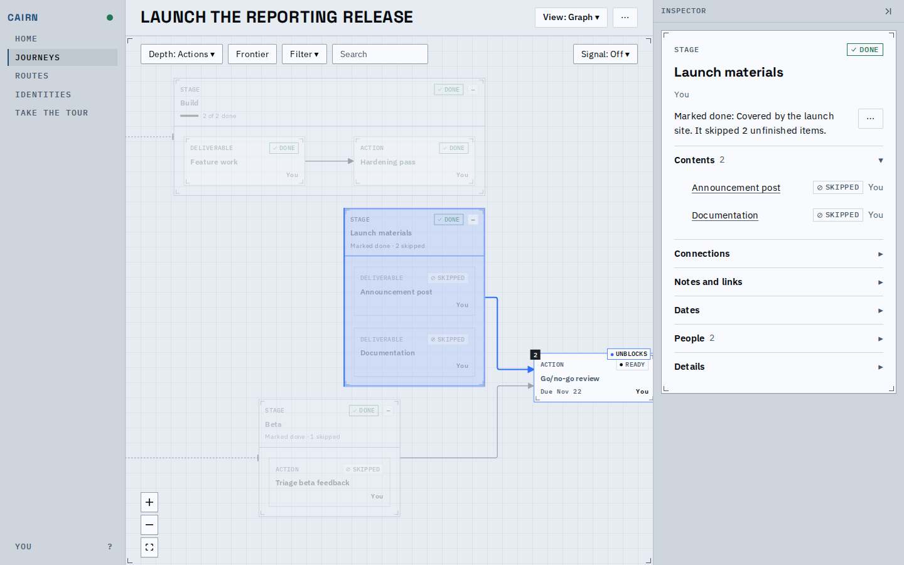
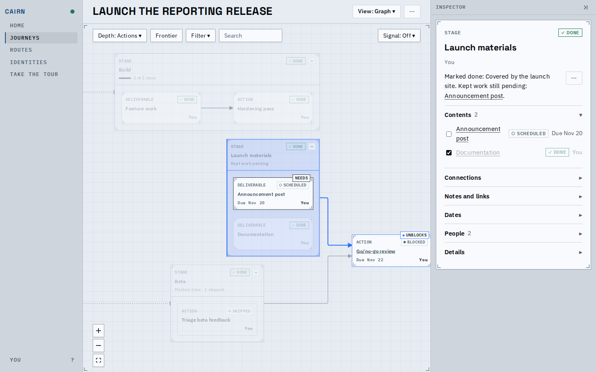
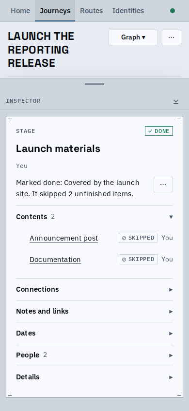

# A stage marked done: honest tags, one owner word, no tick on skipped work

Select a stage that was marked done and the graph now says what is true about it: only
work the stage still waits on carries a NEEDS tag. Skipped work and finished work no longer
do. Owners read the same on the canvas and in the inspector, and skipped items in Contents
no longer offer a checkbox.

## Before and after

| | Before | After |
|---|---|---|
| Stage marked done, both children skipped | both cards tagged NEEDS | no NEEDS tag |
| Same stage with one item kept | the kept item and the finished one tagged NEEDS | only the kept item that is still open is tagged |
| The viewer's own items | cards say "You", Contents says the person's name | both say "You" (a name for anyone else) |
| A node nobody owns | the card says No owner, the inspector, list rows and Filter say Unassigned | all four say No owner |
| Skipped item in Contents | an empty checkbox that reads as "tick to finish" | no checkbox, as the canvas offers no finish on it |

The same rule holds for a skipped stage: it needs only kept work still open beneath it.
Finished kept work is no longer needed, so its tag goes when it is done.

Both children skipped: nothing is tagged NEEDS, and the owner column reads You on cards and rows.

Announcement post is kept and still open, so it alone is tagged NEEDS and holds the go/no-go
review. Documentation is finished and is not tagged.

On a phone the skipped rows carry their status and owner only.

## Known limits

- A skipped item's gravity still counts in its rank explanation; only the trace changes.
