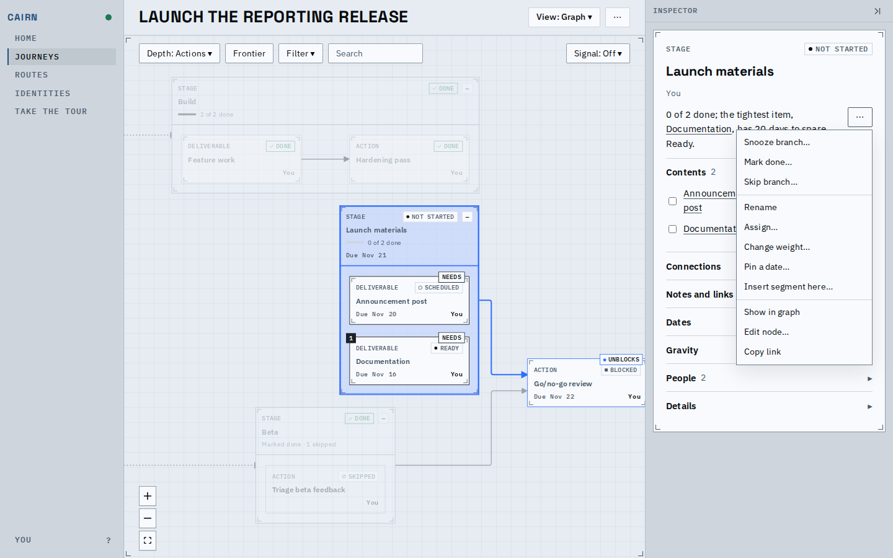
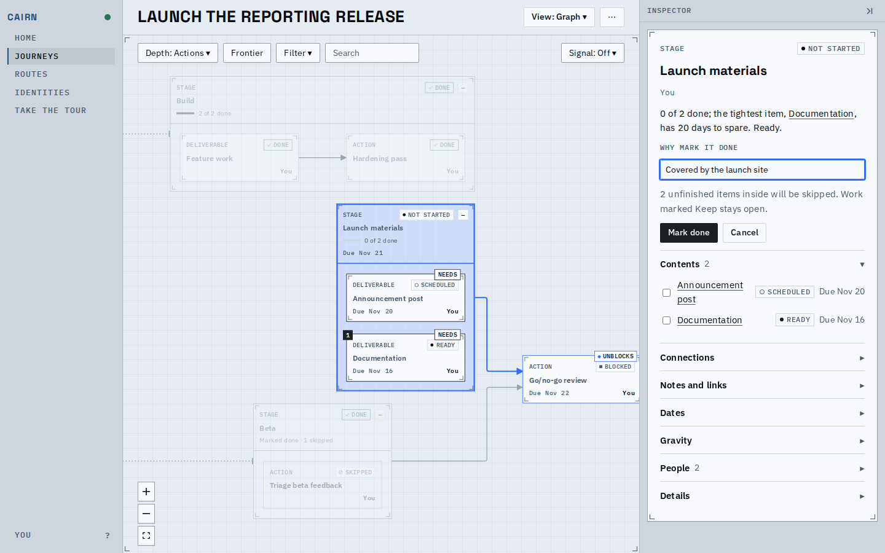
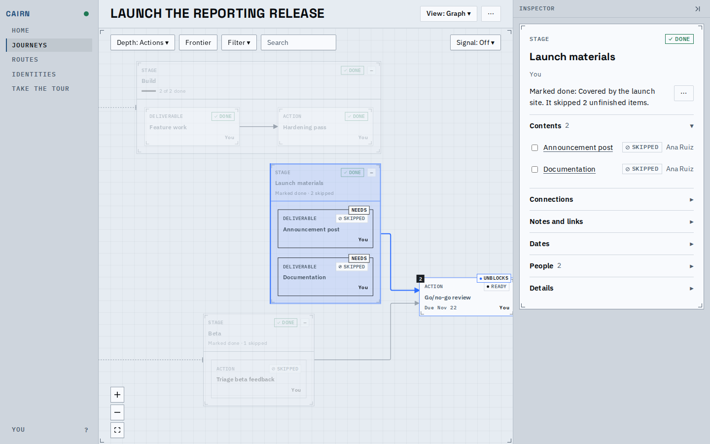
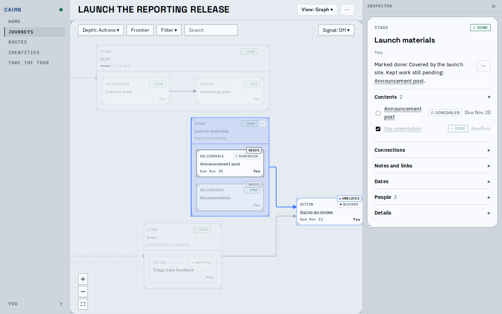
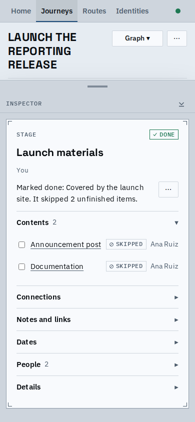

# A stage marked done

A stage, or any group, can be finished while work inside it is still open. Marking it done
takes a reason; the unfinished work inside then reads skipped, as under a skip, the stage
reads done, and what waited on it is free. Reopen takes the mark back.

## Marking Launch materials done

The practice launch journey, with the Beta stage already marked done, so the go/no-go review
waits only on Launch materials. In the stage's `...` menu, Mark done sits beside Skip:

*The stage before: not started, with Mark done at the top of its menu.*

*The form: the field has its label above it, a line says how many items will be skipped, then the actions.*

*After: the stage reads done and says "Marked done, 2 skipped" in place of a progress meter,
both items read skipped, and the go/no-go review is ready.*

*Documentation was finished first and stays done. The announcement was kept after the mark,
so it stays open: the stage says "Kept work pending", and the inspector names it.*

*The inspector sheet on a phone, after marking done.*

<video src="flow.webm" controls width="640"></video>

*The flow: open the stage, choose Mark done, give the reason, send, then Reopen.*

An agent does the same with the `mark_done` transition and undoes it with `reopen`.

## Before and after

Real values from the journey above (Beta already marked done):

| node | before | after |
|---|---|---|
| Launch materials | not started | done, with the reason |
| Announcement post | scheduled | skipped |
| Documentation | ready | skipped |
| Go/no-go review | blocked | ready (still blocked while kept work is open) |

## Known limits

- The card does not show the reason; the inspector does, as for a skip.
- Work that is not a group has no Mark done: finishing a deliverable or action with open
  children is still Done anyway, which leaves the children open.
