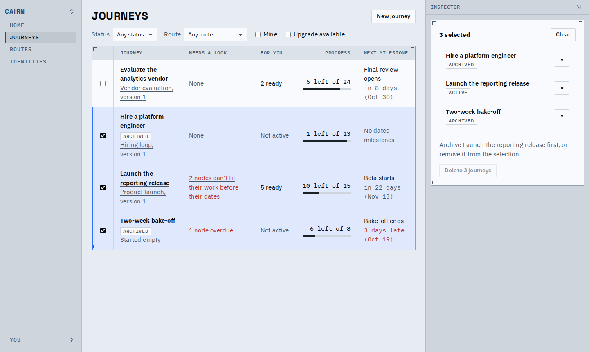
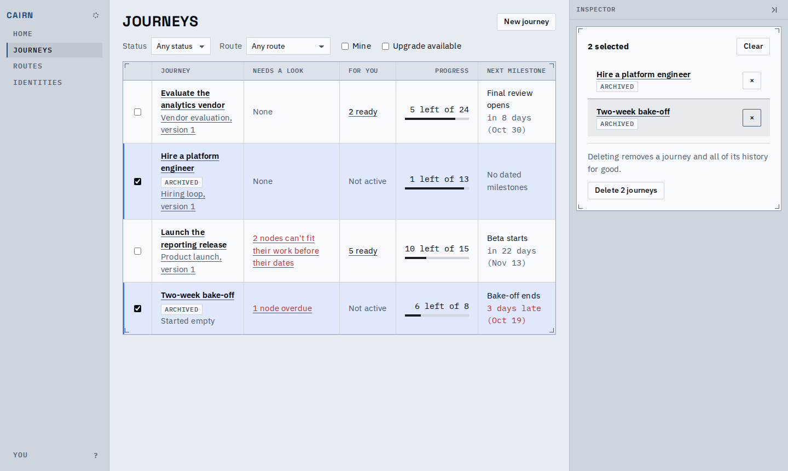
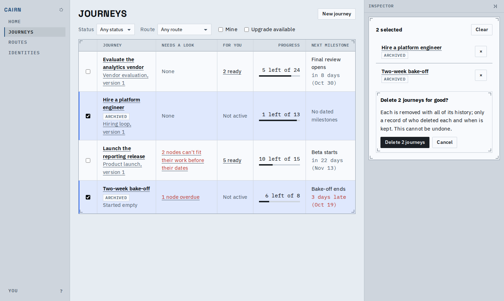
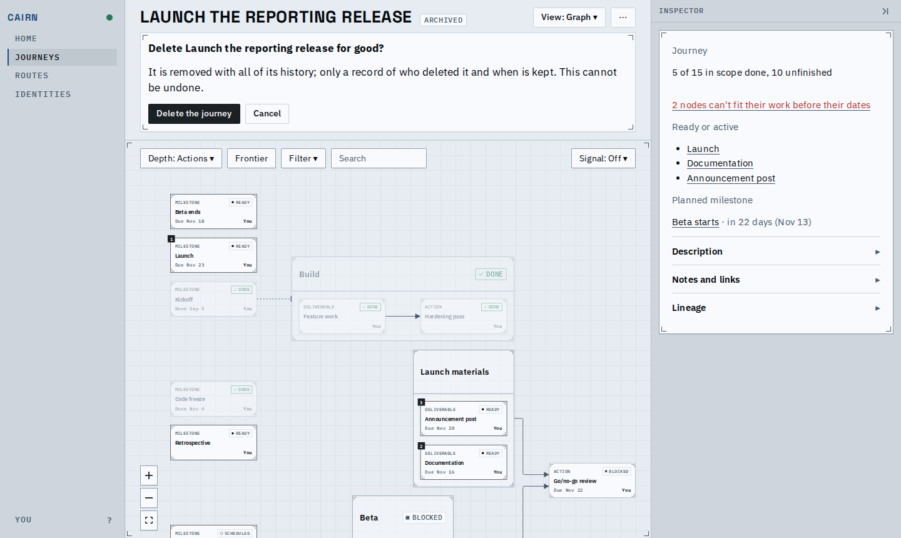
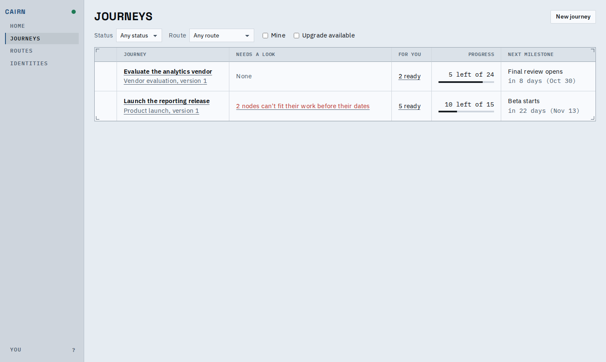
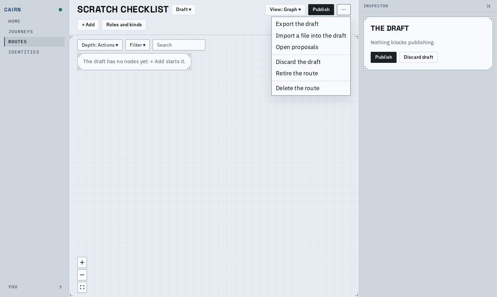
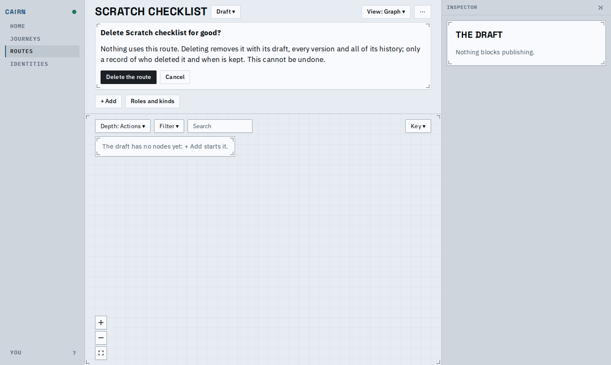
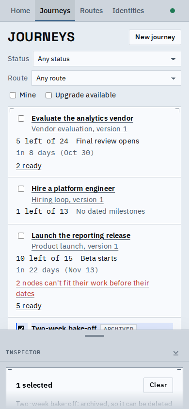
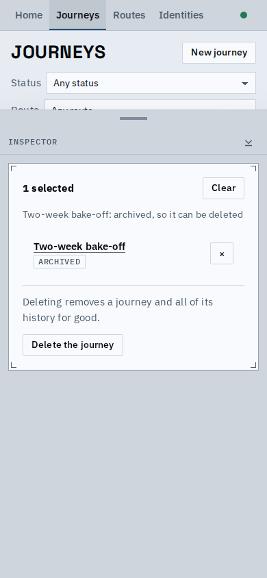

# Delete journeys together, and routes nothing uses

Archived journeys can now be deleted several at once from the journey index, and a route or
segment that nothing uses can be deleted from its menu. Either is one write: every journey
named goes, or none does, and a deleted id is never used again.

Pick journeys with their checkboxes (or Shift-, Cmd- or Ctrl-click a row). The inspector lists
them in the table's order with each one's status; while one is not archived, Delete stays off
and says which.

Taking it out of the selection turns Delete on.

Delete asks once, with the count. The journey header's own Delete asks the same question for one.

Both journeys leave the index at once.

The whole flow: [delete-journeys.webm](delete-journeys.webm)

A route's `⋯` offers Delete only while no journey follows any of its versions and no journey or
route holds an insertion of it, and asks once; Publish and Discard step aside until it is
answered.

On a phone the checkboxes are always shown, beside each journey's name, and the inspector's peek
says whom the selection names and whether they can go; opened, it is the same panel.

Agents delete the same way: one write to the deployment naming each journey or route and the
revision its list row gave. A route still in use is refused, naming the journeys and routes that
use it; deleting those journeys in the same write lets both go. A journey started on a route,
or an insertion of it, that reaches the store after the route was deleted is refused too.

Known limits:
- A route in use offers no Delete in its menu and no reason there; its card lists the journeys on
  each version, and retiring it hides it from new journeys.
- Selection on the index is kept only while the page is open.
