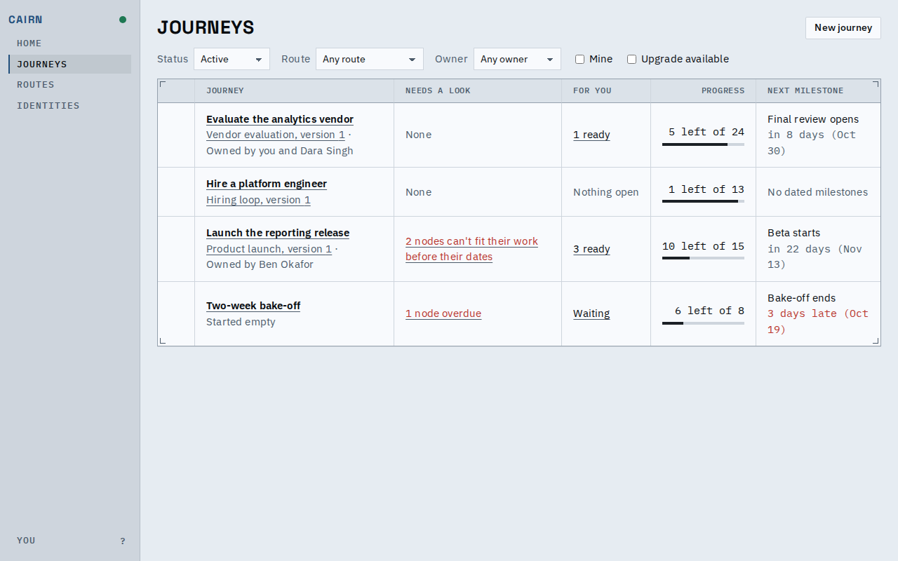
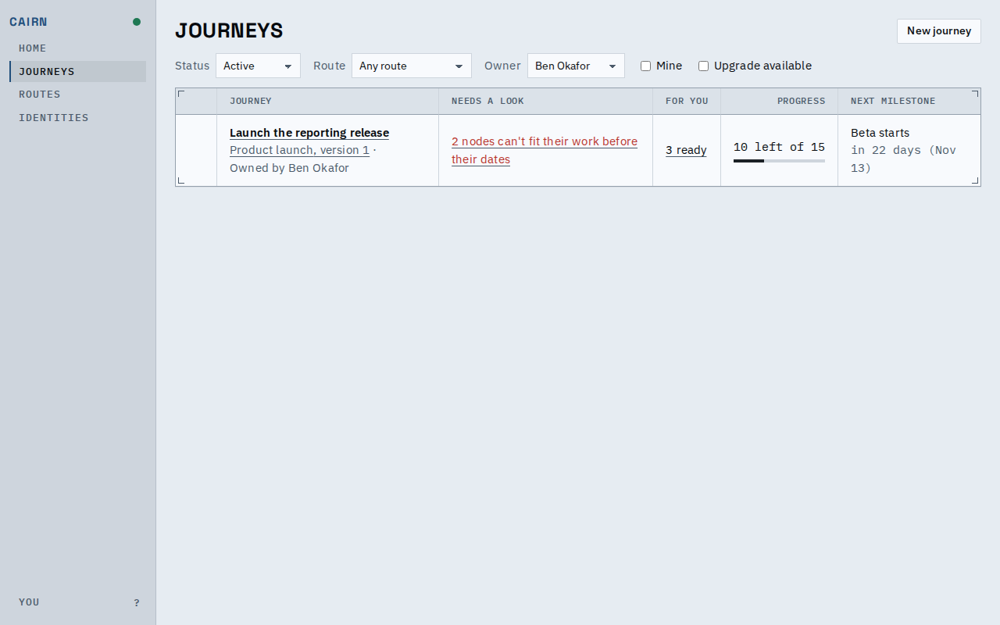
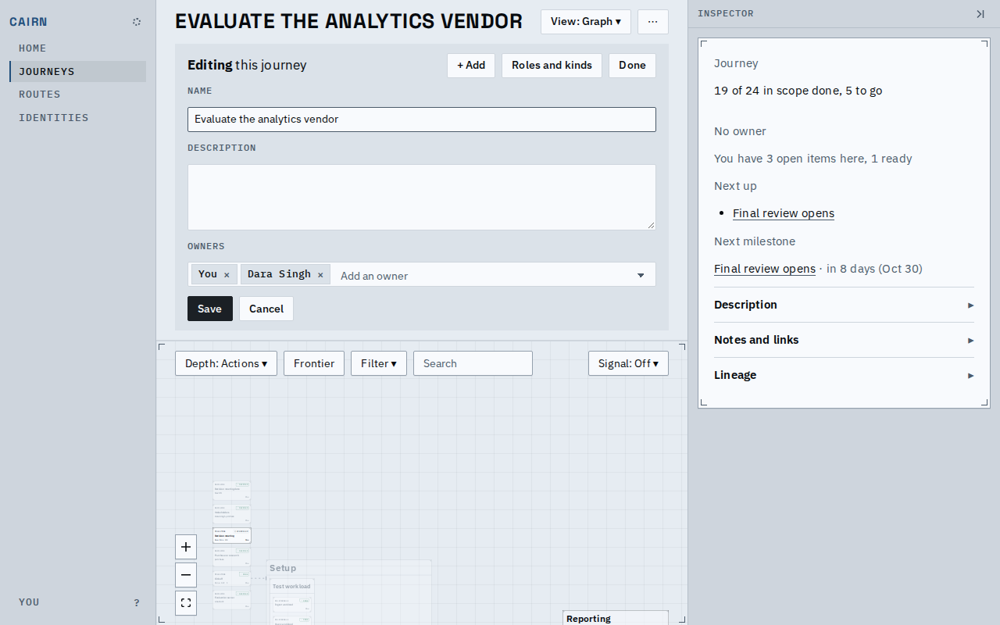
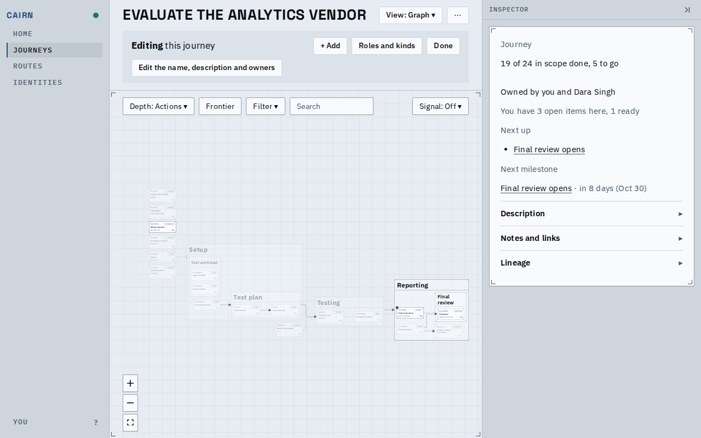
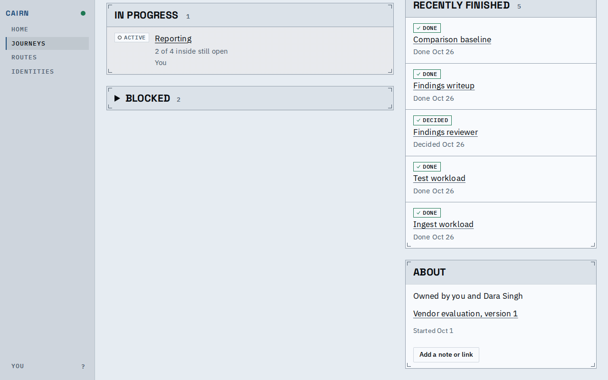
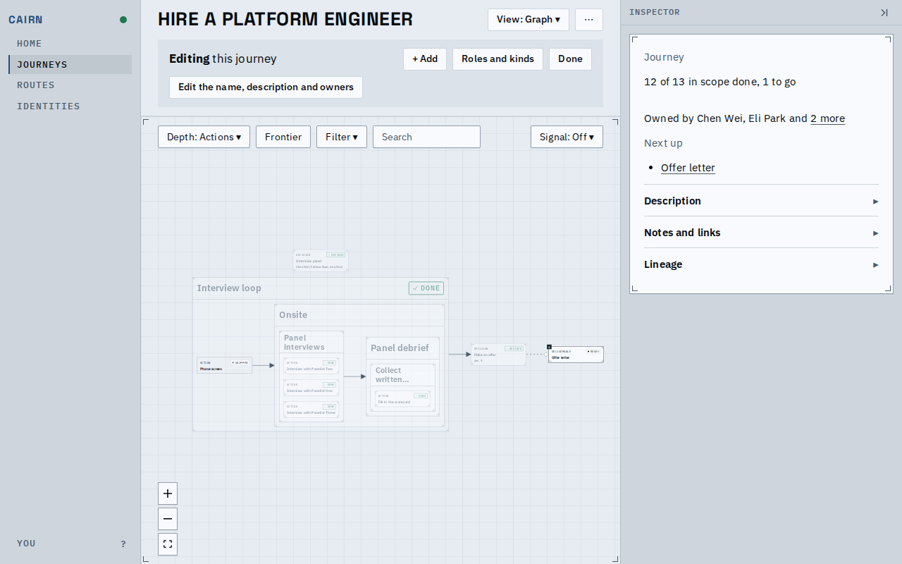
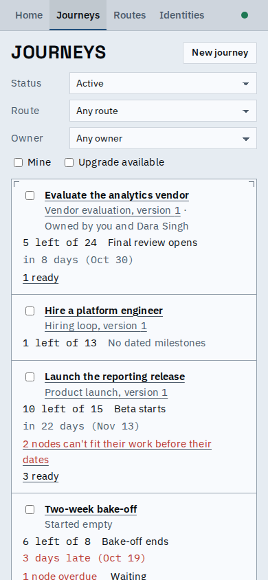
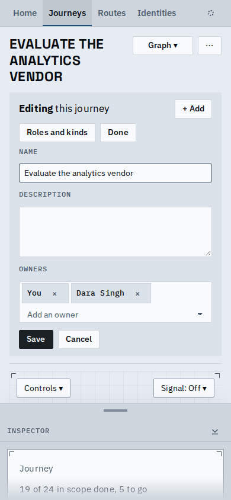

# A journey names who owns it

A journey now names who owns it. Edit mode has an Owners field under the description; the
owners show on the journey card, on the Summary's About, and on each row of the journey
index, which can be filtered by owner. Owners are chosen from the deployment's identities, and
none are assumed: not the creator, not anyone by default.

The index: a row's second line carries where it came from and who owns it; a journey with
none says nothing there.

The Owner filter narrows the index to the journeys one person owns.

Edit mode: the name, description and owners are one form. Chips are the owners chosen (your
own reads "You"), each with a remove cross; the select adds another.

The journey card: "Owned by you and Dara Singh", or "No owner" when it has none.

The Summary's About opens with the owners, all of them (the card names three and the rest as
a link here).

With more than three owners the card names two and links "2 more" to the Summary.

On a phone the owners stay on the row's context line.

On a phone the field wraps and Save stays in reach.

[A short video](owners.webm) walks the flow: add owners in edit mode, save, then filter the
index by one of them.

Agents see the same facts: the snapshot opens with the journey's name, description, status
and owners; `list_journeys` rows carry owners and take an owners filter; `create_journey`
and `edit_journey` set them (left out keeps them, a list replaces them, an empty list clears
them). An owner is an identity reference: the identity cannot be deleted while a journey
names it, and a merge moves the owner to the survivor.

A journey you own is under Mine even when none of its work is yours.

Known limits:
- The field picks existing identities only; a new person is added on the Identities page.
- Home lists no journey for being owned, though proposals for journeys you own now wait on
  you there.
