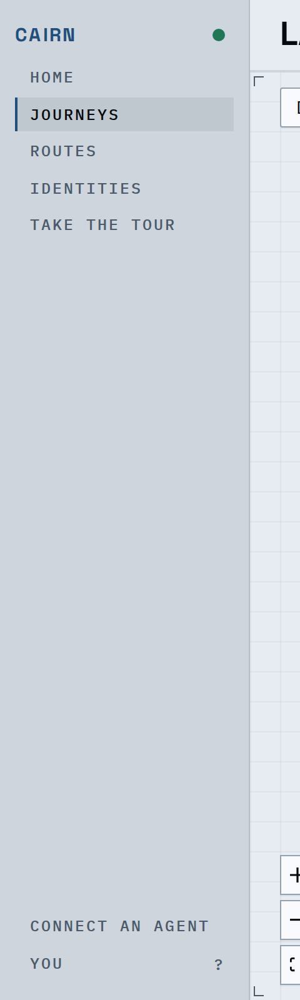
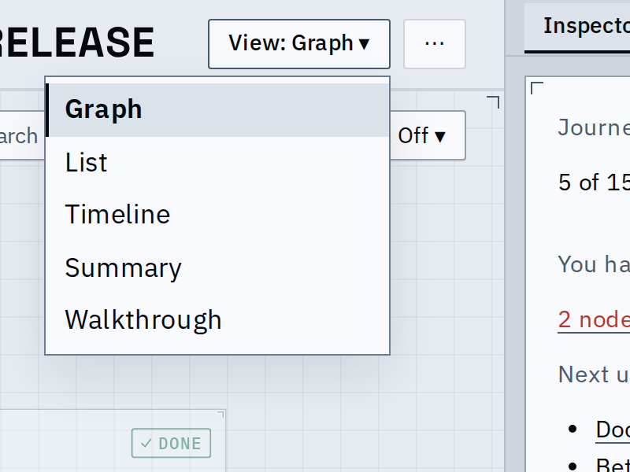
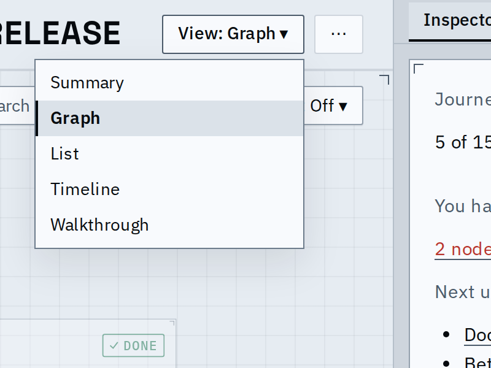
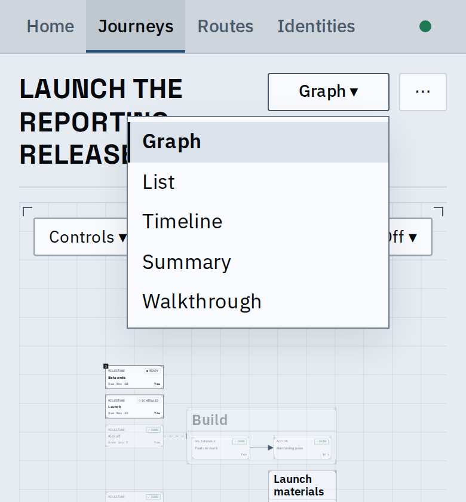
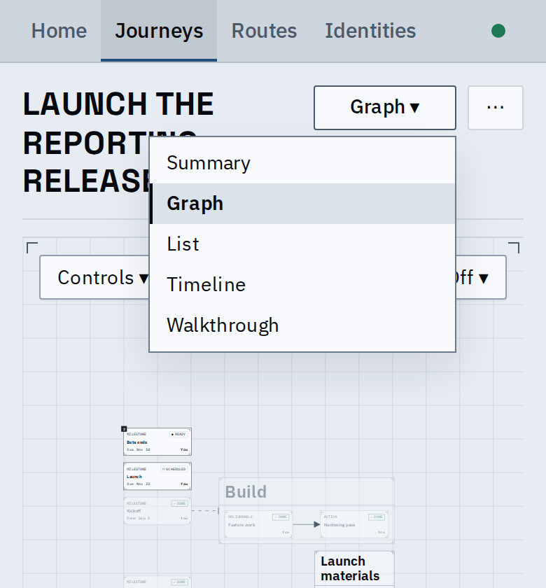
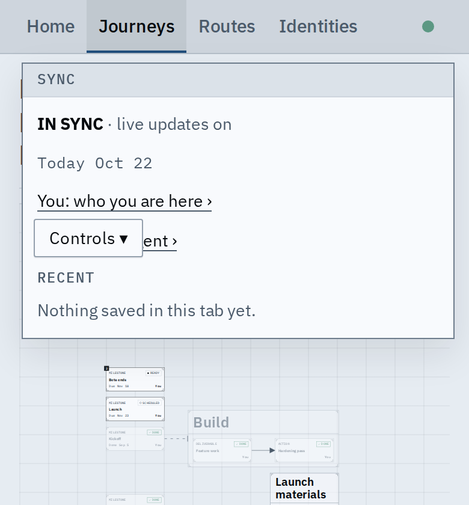
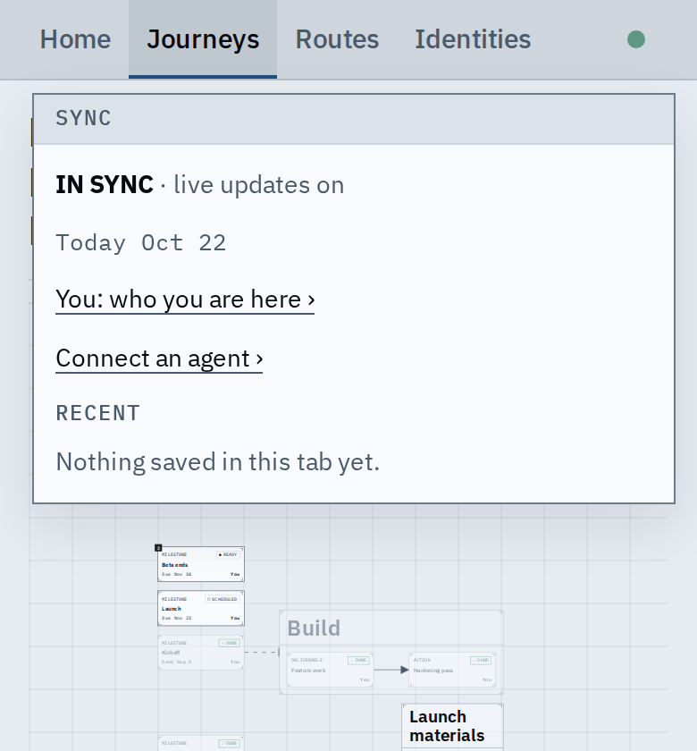

# Navigation order: You first, the landing view first

A person now sees You above Connect an agent in the rail, and the View
picker lists the view a journey opens on, the Summary, at the top.

## The rail (desktop)

| Before | After |
| --- | --- |
|  |  |

You keeps the shortcuts hint on its line; Connect an agent sits below it.
On a phone the two are links in the sync popover, which already listed You
first; the order is the same there.

## The View picker

| Before (desktop) | After (desktop) |
| --- | --- |
|  |  |

| Before (phone) | After (phone) |
| --- | --- |
|  |  |

The order is the per-view table's, and nothing else lists the views. A
route opens on its Graph, which is already first, so its picker keeps
Graph, List, Timeline.

## Also fixed: the phone's sync popover

The Controls button was painted over the popover's Connect an agent link.
The rail now stacks above the view's controls.

| Before | After |
| --- | --- |
|  |  |

## Also fixed: menu text size

Menu items took the popover's 17px body size; they are now the 14px the
menu spec names, so the picker no longer outweighs its trigger.

## Known limits

- The keyboard `v` still cycles the Graph, List and Timeline only, as before.
