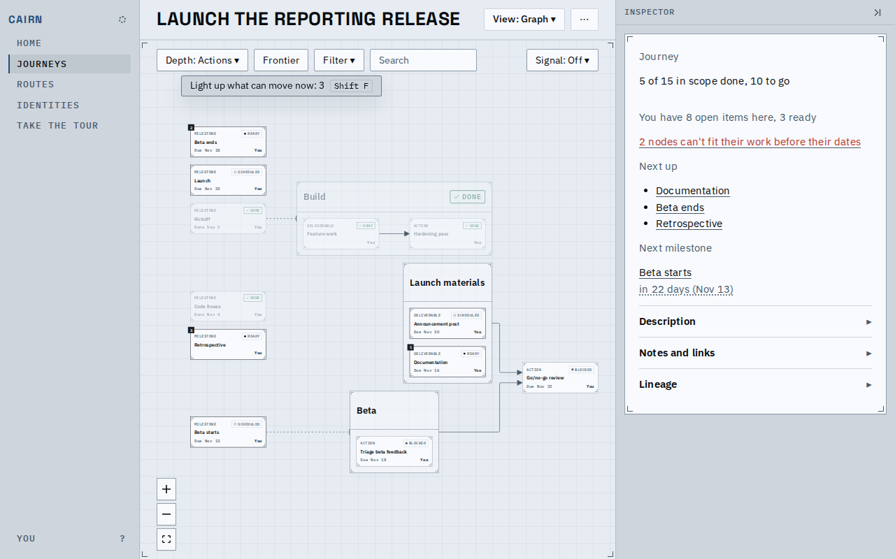
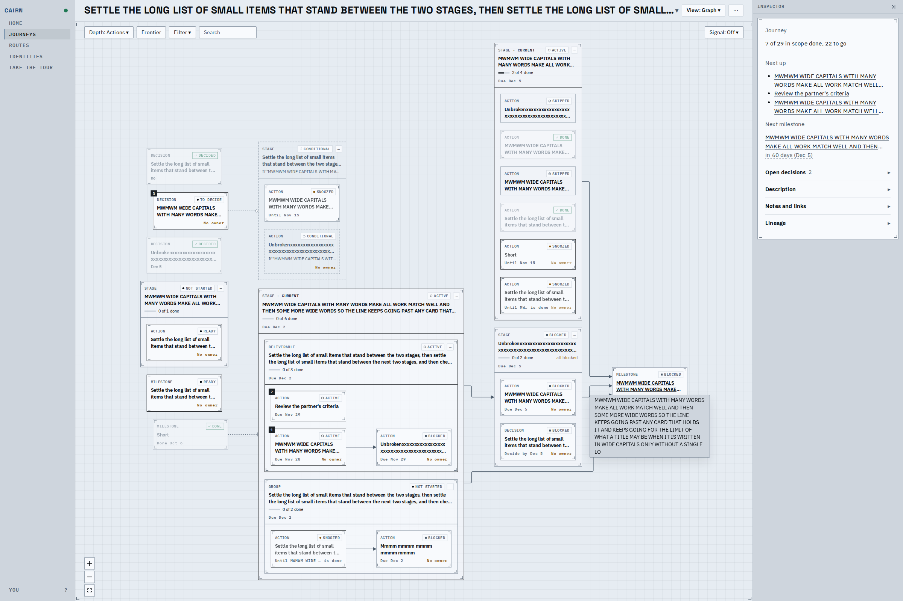
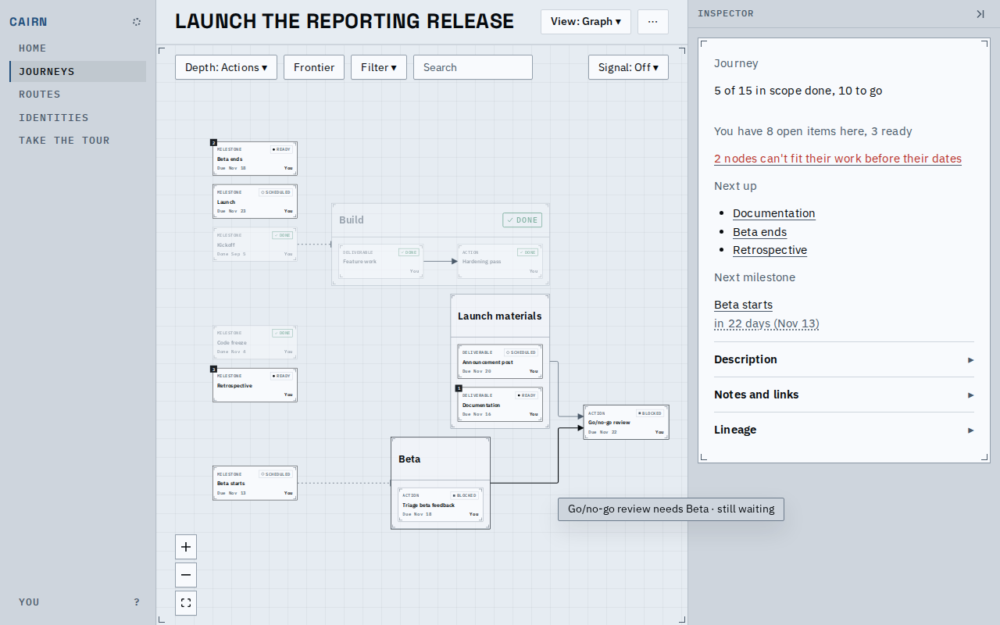
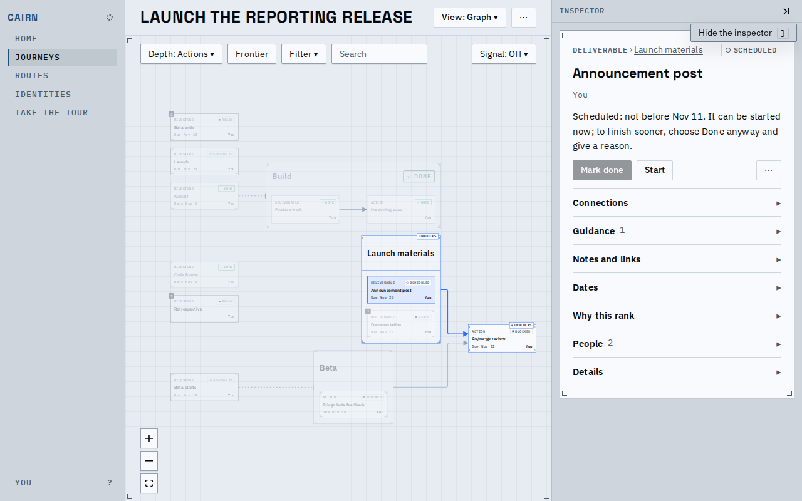
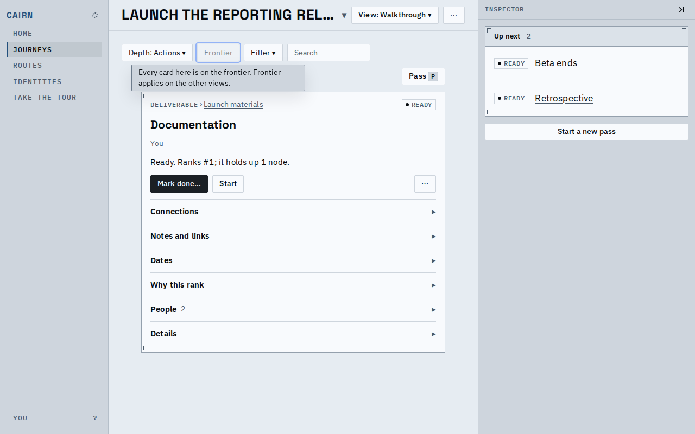
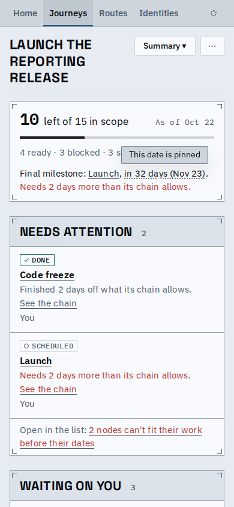
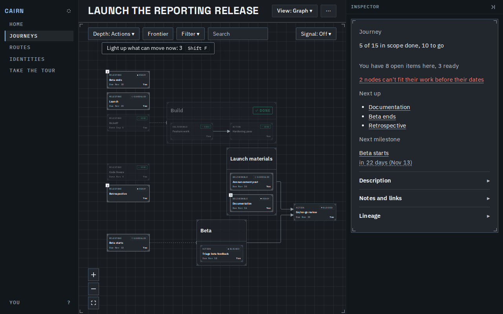
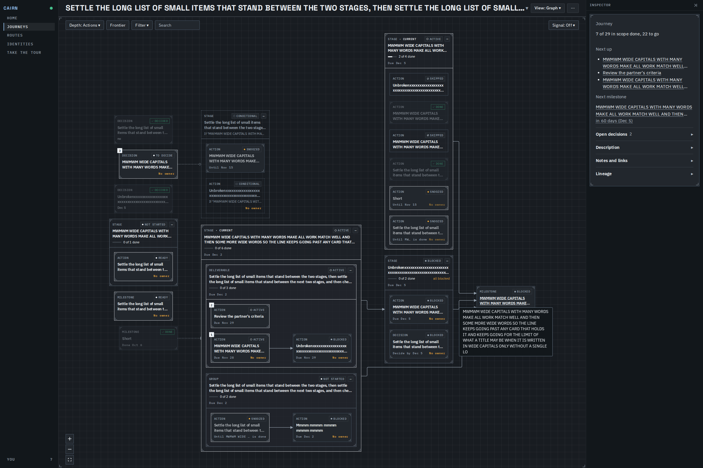
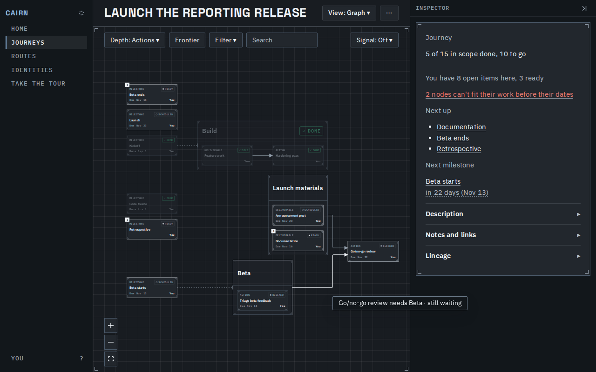

# One tooltip

Every tooltip in the app is now one prompt, styled tip; the browser's delayed one is gone. A tip
shows 300 ms after the pointer rests (at once when it moves between neighbours), at once on
keyboard focus, hides on Esc, blur or leaving, stays inside the window, and is read out as the
description of what it belongs to.

A control's tip, with its key drawn beside the words.

A card title that the card cuts short shows its whole text in the tip. A title that fits shows no tip.

A graph line's words, the old edge chip, are the same tip.

A tip near the window's edge slides inside it rather than being cut.

A control that cannot act here takes the focus and says why; pressing it does nothing.

Where a tip is the only place a fact lives, a tap shows it (dotted underline), above the fact so the finger and the line below stay clear; Tab and Enter reach it.

Dark mode uses the same tokens.

<video src="flow.webm" controls muted></video>
The pointer onto Depth, across to Frontier (no wait), off; then Tab through the controls and Esc.

Known limits:
- A tip is not shown on touch hover; only facts with no other home are tappable.
- The picture of a tip over a very large graph is shown at the card's scale; the tip itself is not zoomed.
