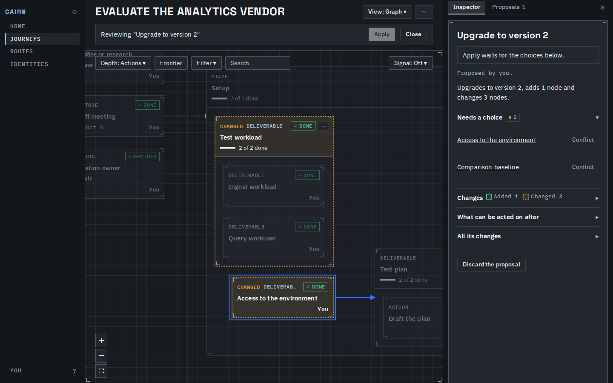
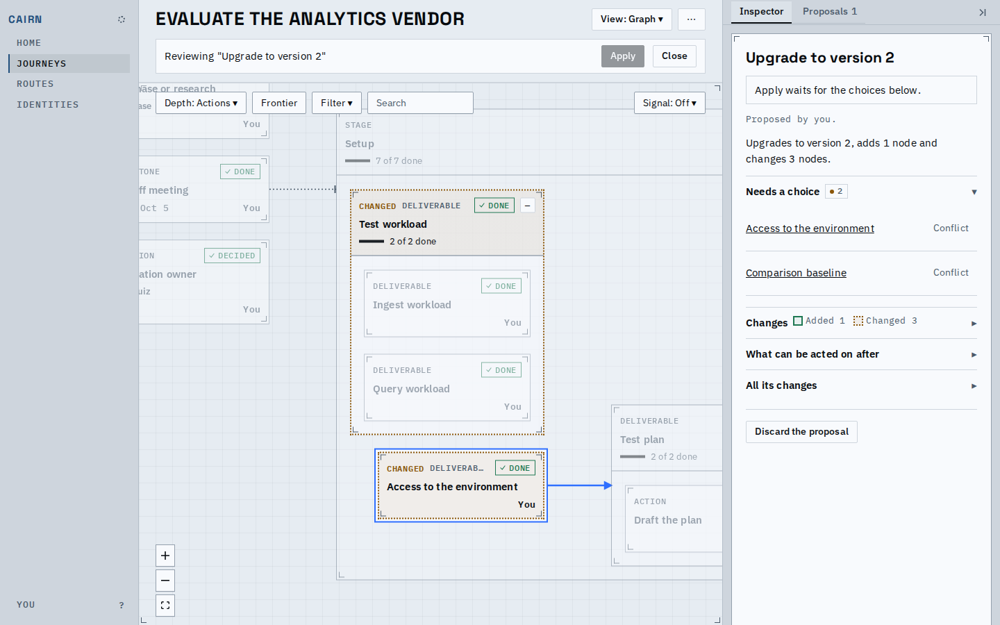
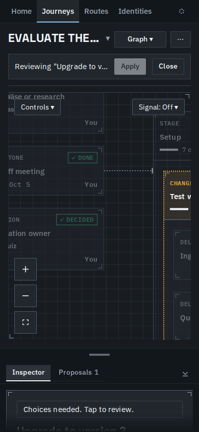

# One owner for the design tokens

Dark mode's proposal diff fills now keep muted text legible, and the design tokens are the only place a colour, a frame width or a card measure is written.

## Dark diff fills

Muted text on an added, changed or removed fill, dark theme, before and after (floor 4.5:1):

| Fill on | Added | Changed | Removed |
| --- | --- | --- | --- |
| paper, before | 4.34 | 4.56 | 4.52 |
| paper, after | 6.75 | 6.74 | 6.95 |
| header band, before | 3.85 | 4.05 | 4.02 |
| header band, after | 5.82 | 5.80 | 5.99 |

The fills are now mixed from the success, warning and error tokens (they had their own hand-written colours, which in dark mode were the light theme's hues) at 8% in light and 10% in dark, and the dark muted text is a step lighter. A green DONE chip on a changed card also measured 4.25:1 in light; the light success ink is a notch darker and the status inks are now held over every fill too. The contrast test covers text and muted over every fill, on paper, band, ground and sunken, in both themes.

Dark: a changed card and its container on their fill, with the legend in the rail.

Light: the same review, the fills a little paler.

Phone width, dark: the changed container on its fill under the sheet's peek.

## One value, one place

- Dark colours are written once, as `light-dark(light, dark)`; the second block of dark values is gone.
- The rail and inspector widths are tokens only; the app's frame reads them (the two files had disagreed, 184/360 against 200/400, and the shipped 200/400 stand).
- A card's row heights, padding and gaps come from the numbers layout counts with, set on each card, so the stylesheet cannot drift from them.
- Popover width and body cap, the axis label size, the theme's storage key and the lint's radius and rem limits each have one owner, and a test holds every stylesheet's window-size query to the sizes the code names.

## Known limits

- Container queries keep their own sizes in the stylesheets; they are sizes of a panel, not of the window.
- The timeline's phone layout now starts at 719px like every other screen (it started at 640px).
