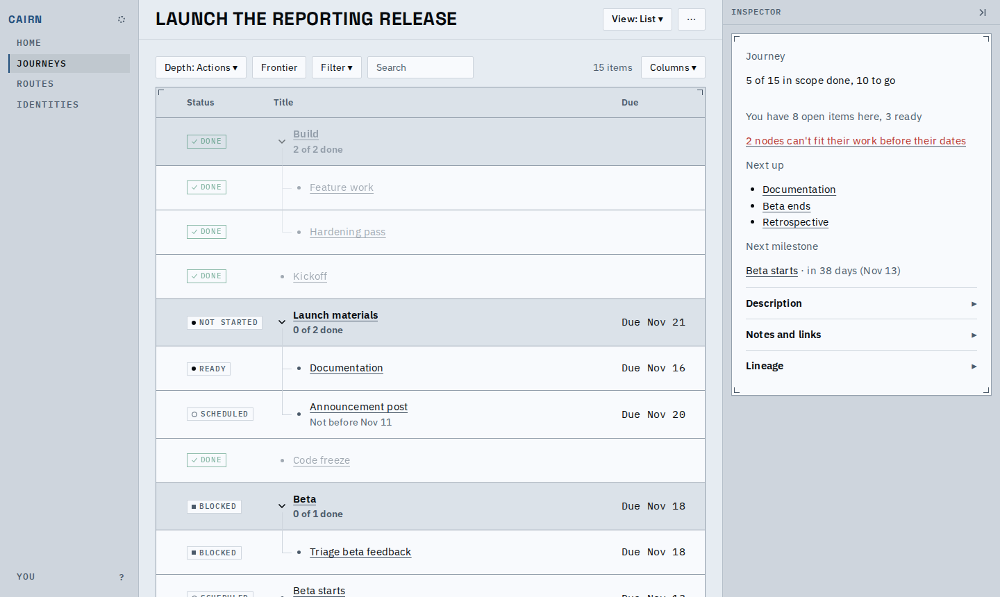
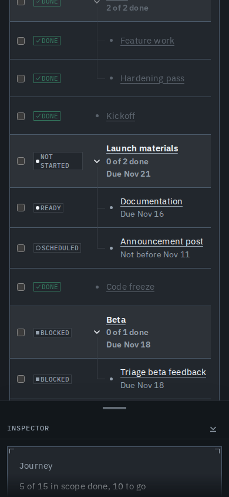
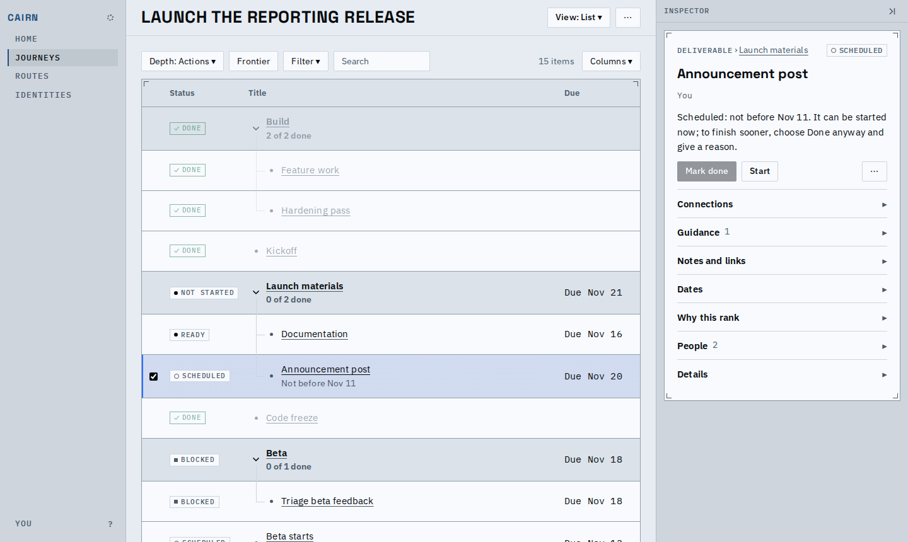
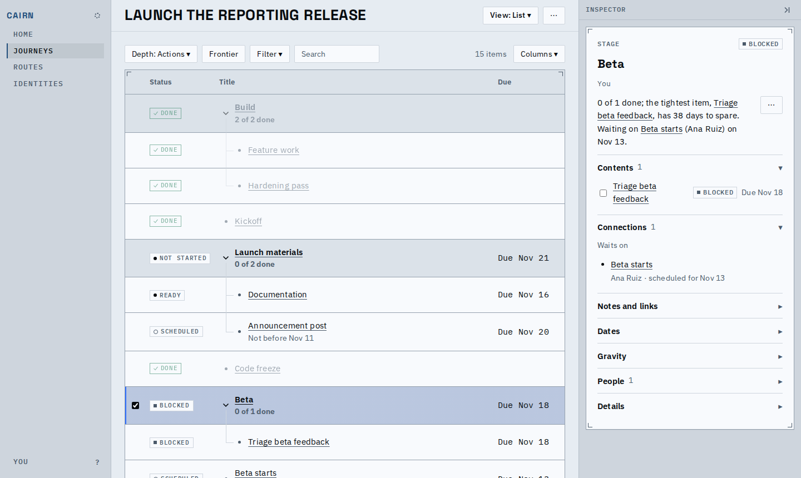
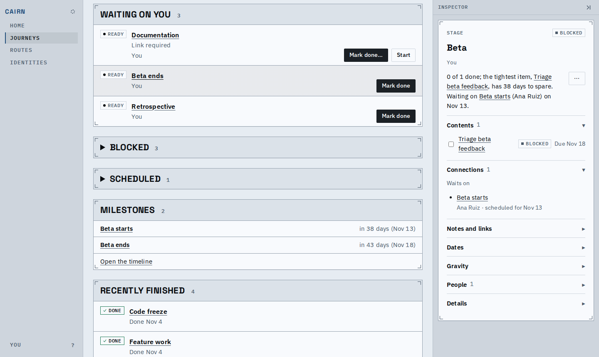
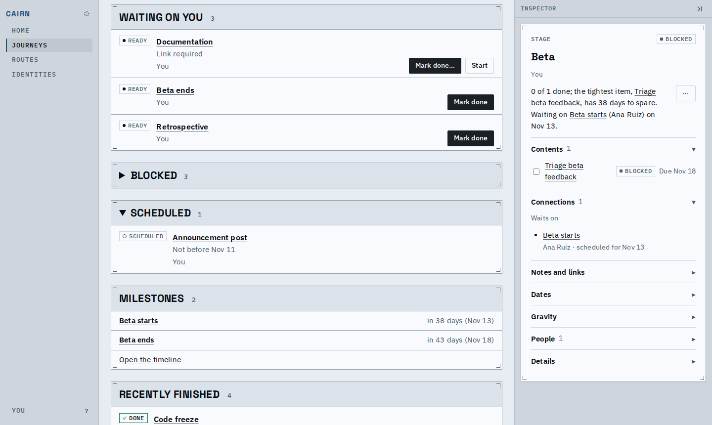
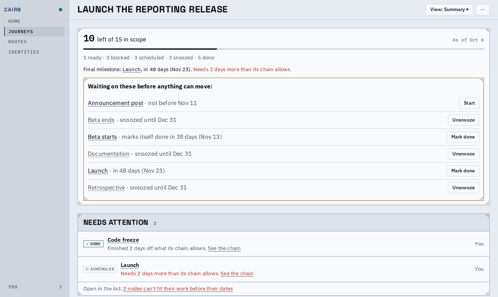

# Work waiting for its date reads scheduled

Anything a date ahead holds now reads Scheduled and leaves the next list: a milestone pinned
to a future day or marking itself done on it, and work or a decision whose own not-before
date is still ahead. What waits on it is blocked and says the date. Work can still be started
early; finishing it before its date needs a reason, and the reason records the date.

The launch fixture, read on Oct 6: the beta's start (marks itself done Nov 13), the launch
(pinned Nov 23) and the announcement post (not before the beta ends, Nov 11) are scheduled.

## In the list

A scheduled row says its date under the title; on a phone that date is its one secondary fact.

## In the inspector

The sentence says when, and how to go early: Start is offered, Mark done is held, and Done
anyway (or Answer anyway, for a decision) takes a reason.

What waits on a scheduled node names its date, in the sentence and under Connections.

## On the Summary

A folded Scheduled panel lists the work and decisions waiting for their date; milestones stay
in the Milestones panel.

With everything ready snoozed, the journey is held only by dates and snoozes, and the stall
panel names each: Start for work, Mark done for a milestone.

The flow, list to inspector to Summary: [scheduled.webm](scheduled.webm)

## Known limits

- A milestone dated only by its deadline (a "due by" date) is not scheduled: it reads ready
  and is marked done when it happens.
- A container's own date never holds its children.
