# Touch targets

On a touch screen every control a finger taps now has a hit area at least 44px each way: Save, Mark done, Start, Back and Next, menu items, options, folded rows, list pick boxes and title links, the sheet's grip and hide button, the zoom buttons. A mouse keeps the compact controls: the desktop screen below is identical before and after.

Dense rows keep their rhythm where they can: a pick box stays drawn as it was and sits in a label as large as the target, a timeline title's link stretches over its row, a title link is padded. The phone Controls menu is also one even column now, each row a target tall with one gap between rows and on both sides of a rule.

| Before | After |
| --- | --- |
| 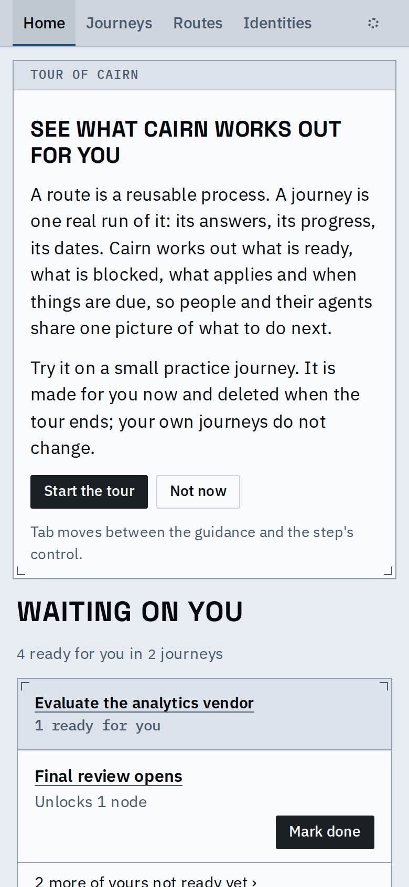 | 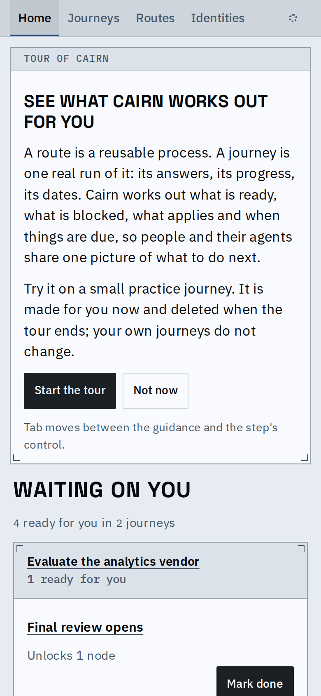 |
| Mark done 34px tall, row titles 26px | Every button and title link 44px |
| 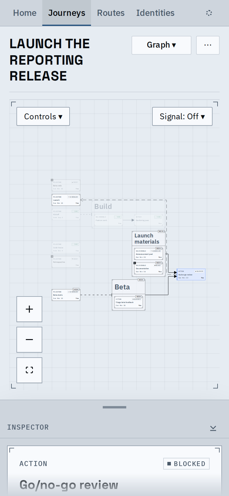 | 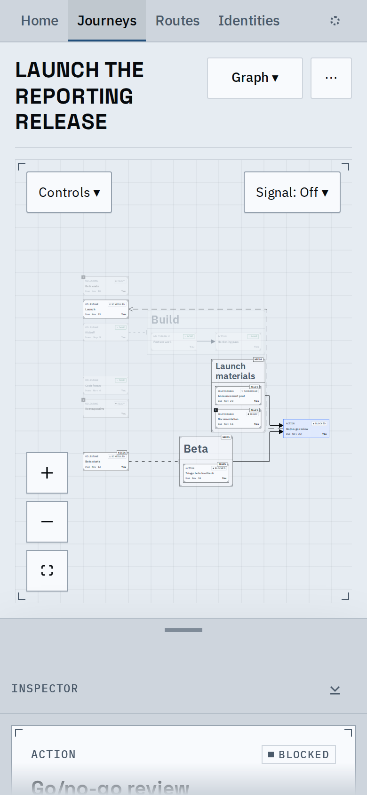 |
| Grip 24px, hide 30px, Controls and Signal 34px, zoom 44px | Grip, hide, Controls and Signal 44px; the peek grew by the grip and hide button's extra height |
| 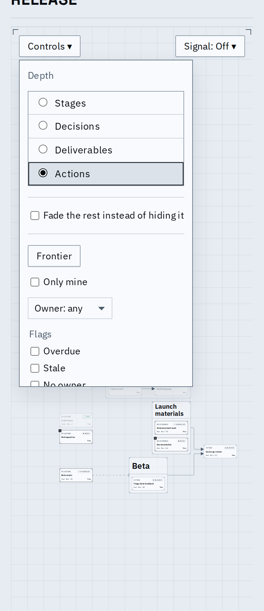 | 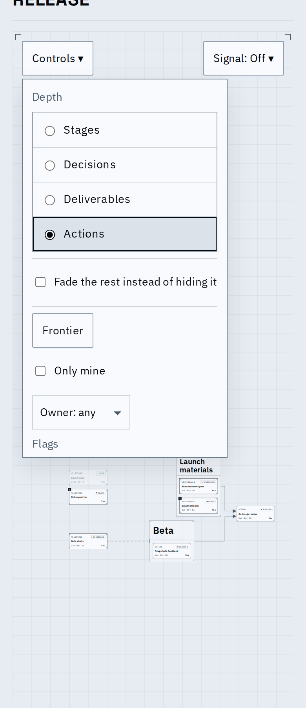 |
| Rows 22-36px at uneven gaps | Rows 44px, one gap |
| 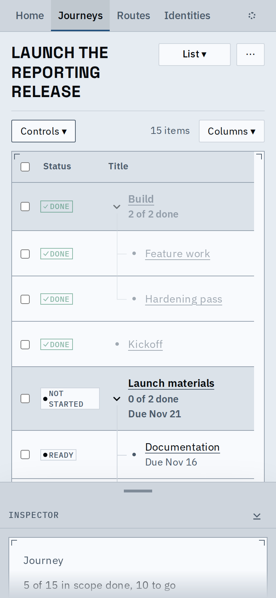 | 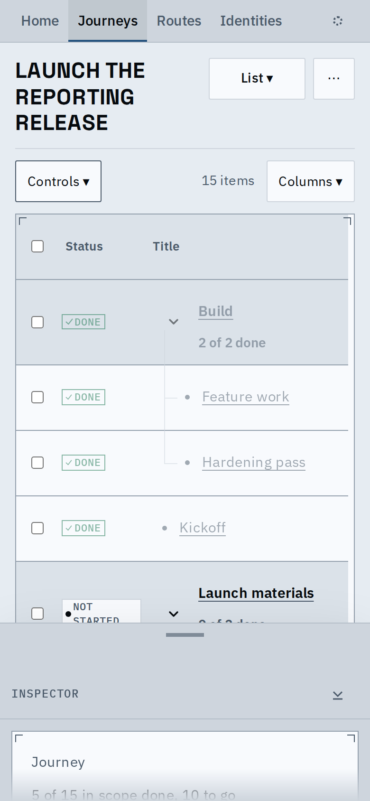 |
| Pick boxes 12px, title links 24px | 44px hit areas, rows as tall as before |
| 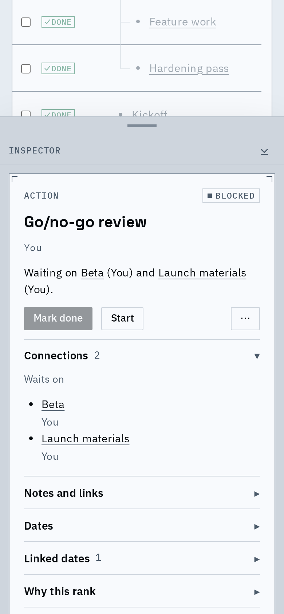 | 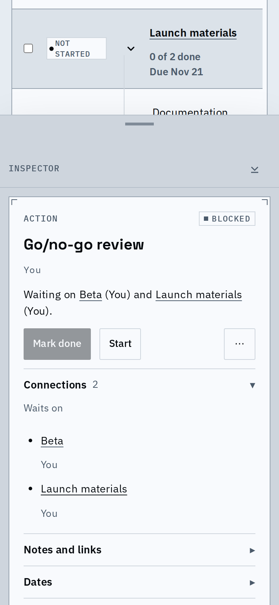 |
| Mark done, Start, menu 34px | 44px |
| 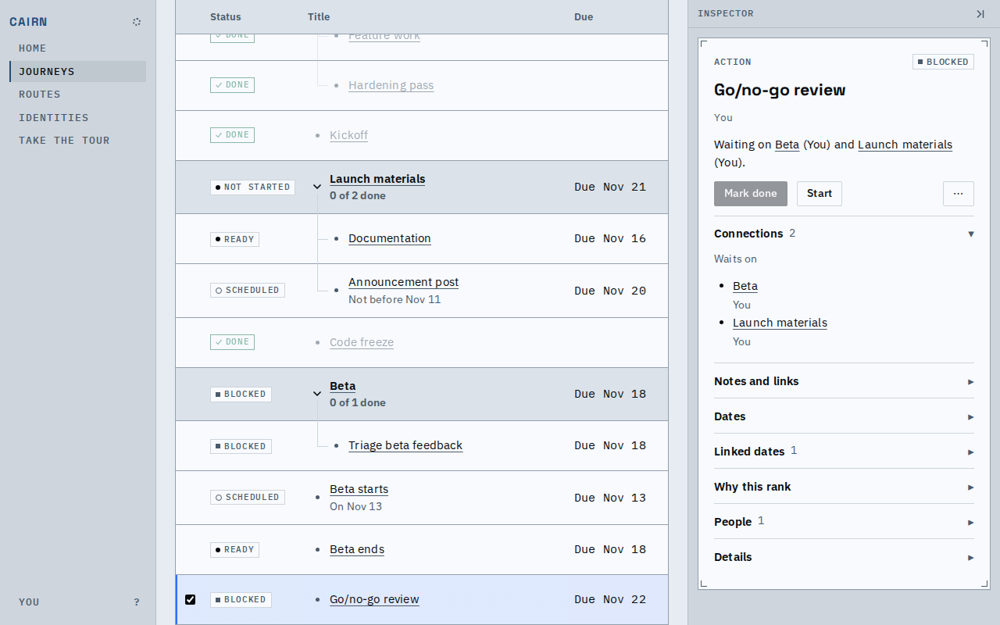 |  |
| Fine pointer | Unchanged |

Known limits:

- Cards drawn on the graph canvas scale with the zoom, so at the fitted zoom they are small; the 44px zoom buttons and a pinch make them larger. A link inside a sentence is held to its words.
- A raised phone sheet's peek is 24px taller on a touch screen, for the larger grip.
