# A tour for new people

Someone new to Cairn can now take a short guided tour. It opens on Home, makes a small practice
journey for them, walks them through five things (six where the deployment has an assistant), and
deletes the journey when it ends. Their own journeys are never touched.

The welcome shows once, on Home only, never over a link to specific work. "Not now" ends the
offers; the rail and the You page still offer it.

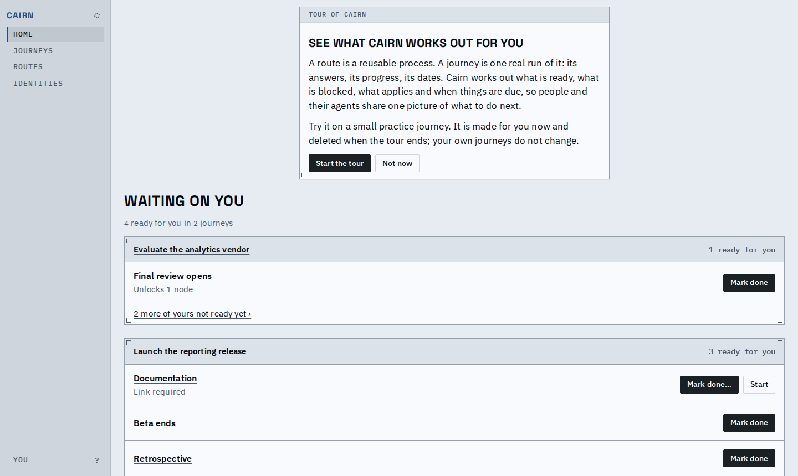
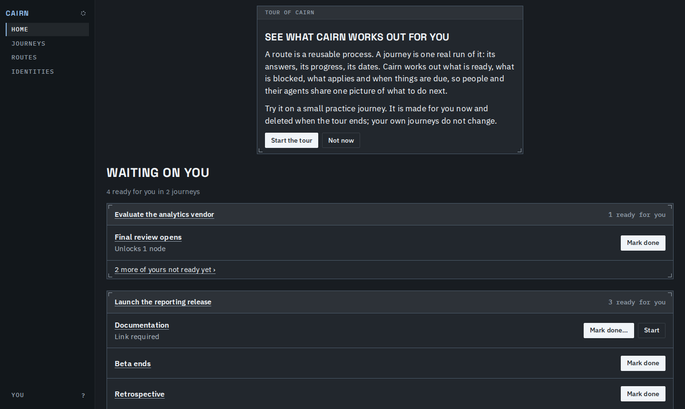
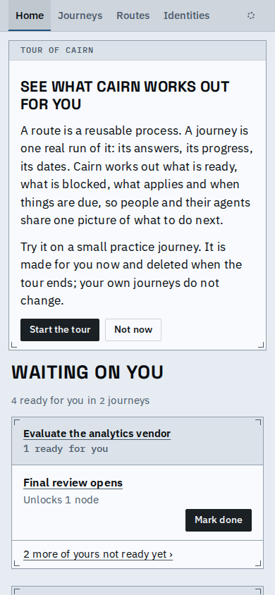

Each step is a band above the screen, so nothing is covered. Next waits until the step's action
has happened in the practice journey itself, and the sentence under the action says what Cairn
worked out from it. Back keeps what was done.

1. Read the map: 'Write the draft' is ready, 'Outside review' is conditional. Select the decision.
2. Answer it. Either answer is a way through; the result says what it did to the review.

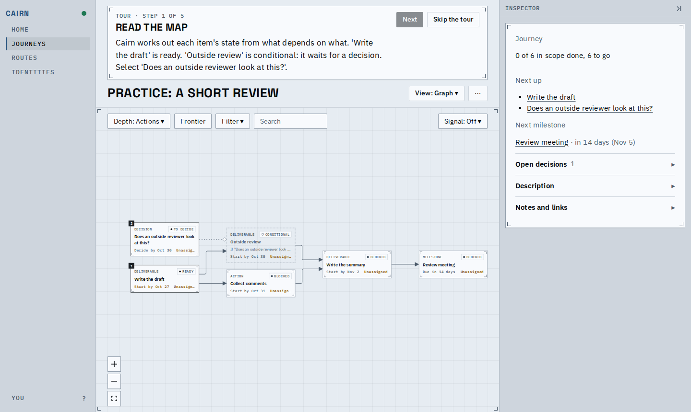
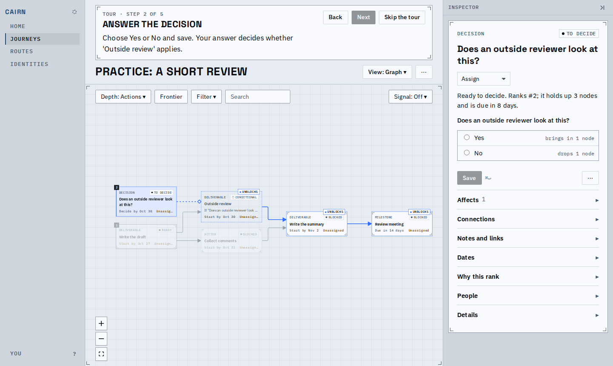
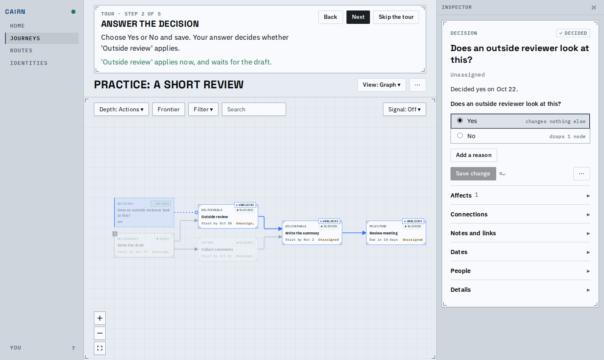
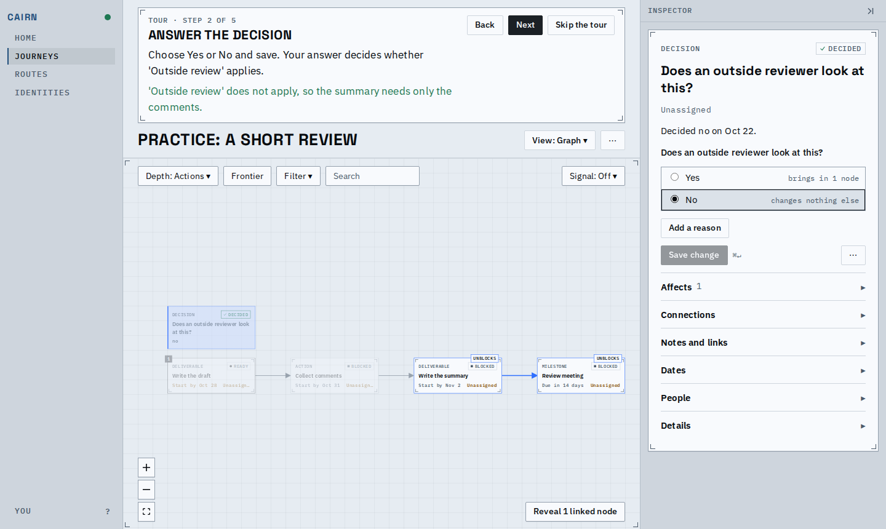

3. Frontier: what can move now. The control is outlined with a dashed line, not a solid focus ring.
4. Finish work: Mark done on the draft in the list, and the two items that waited for it are ready.

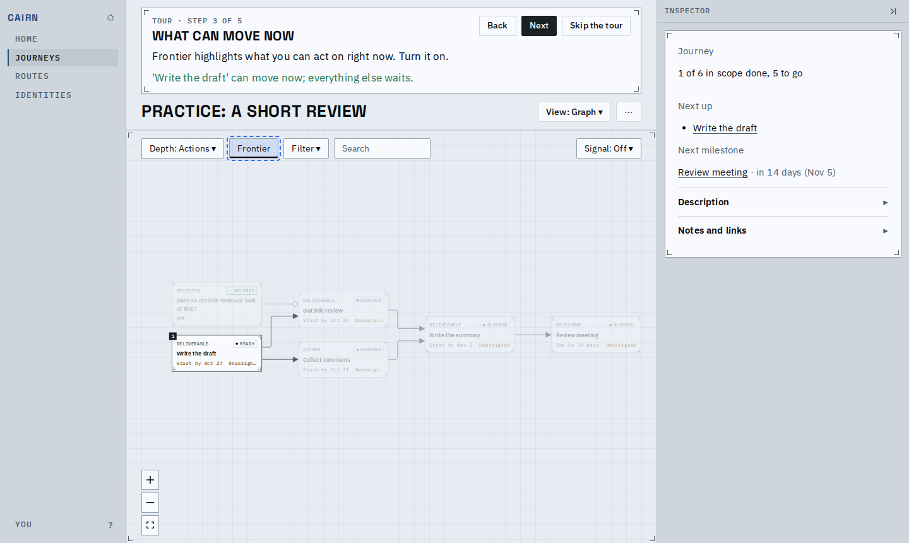
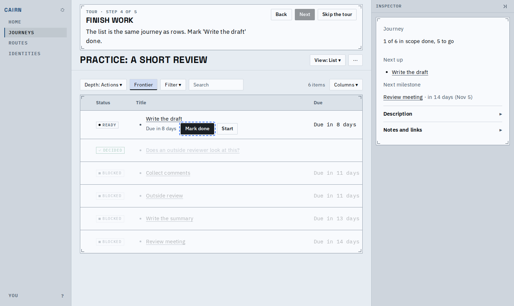
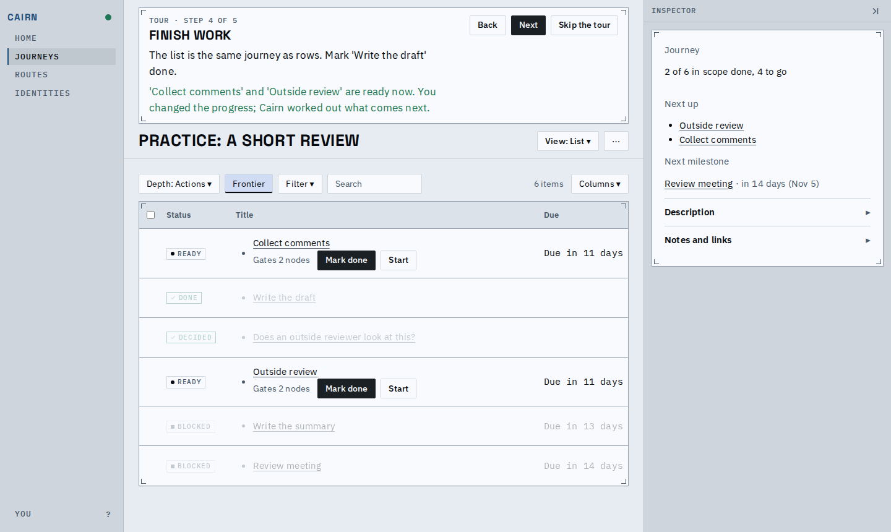
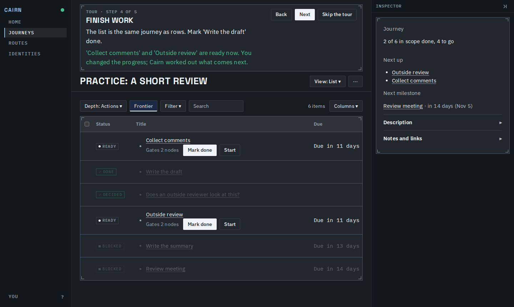

5. Dates: 'Write the summary' is due the day before the pinned meeting, worked out, not typed.
6. Where an assistant is offered: its tab shows a labelled example exchange built from the same
   facts. Nothing is sent to the assistant.

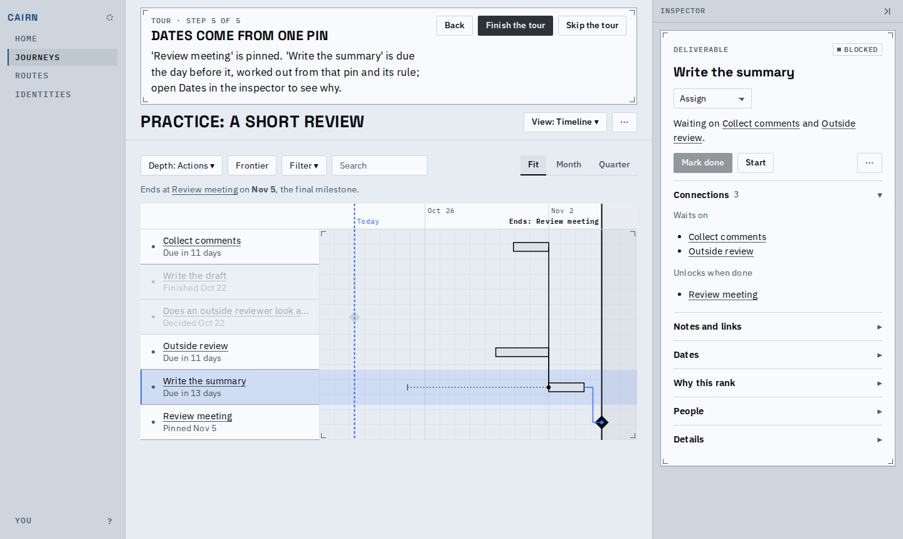
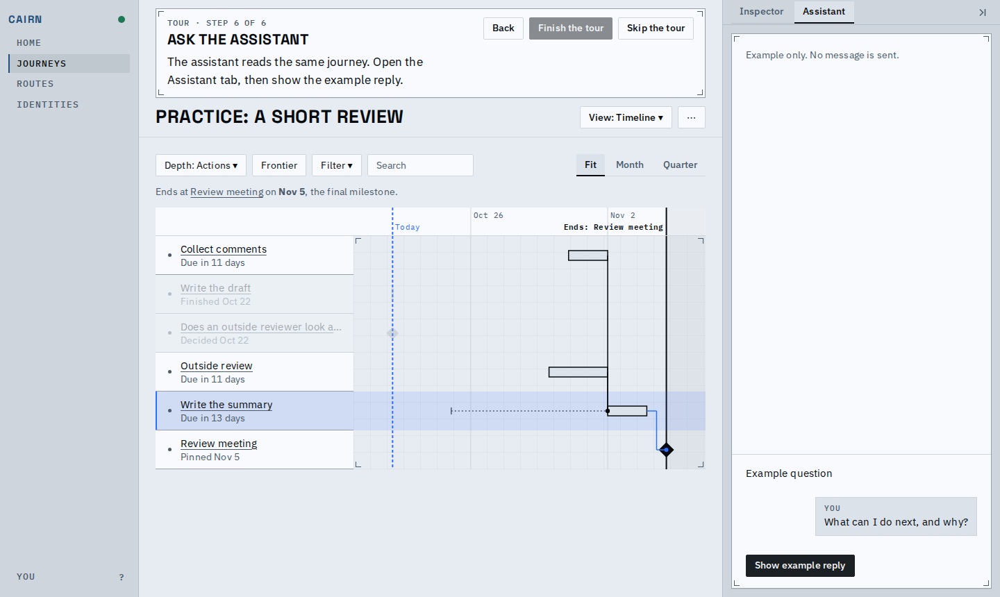
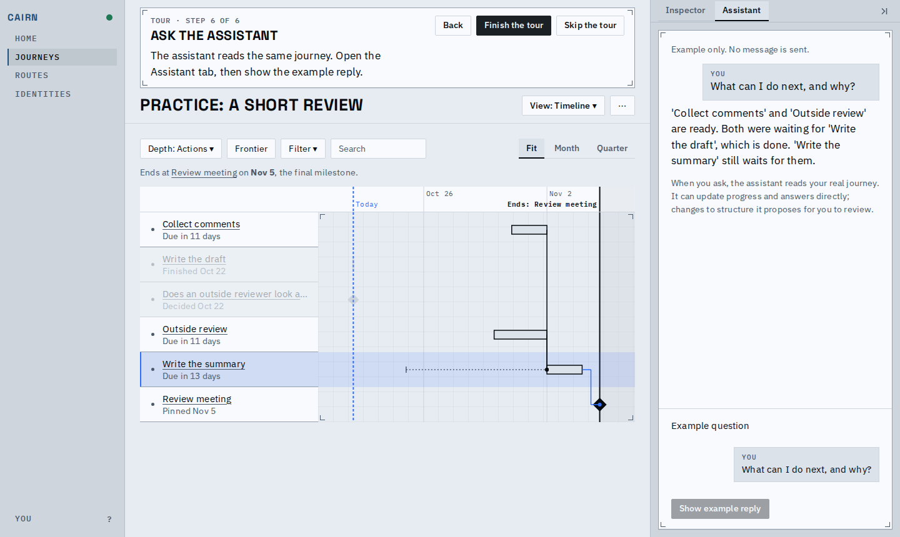

Finishing deletes the practice journey and shows one closing card; skipping at any step does the
same without it. Leaving the practice journey mid-tour shows one "Tour paused" line, with Continue.

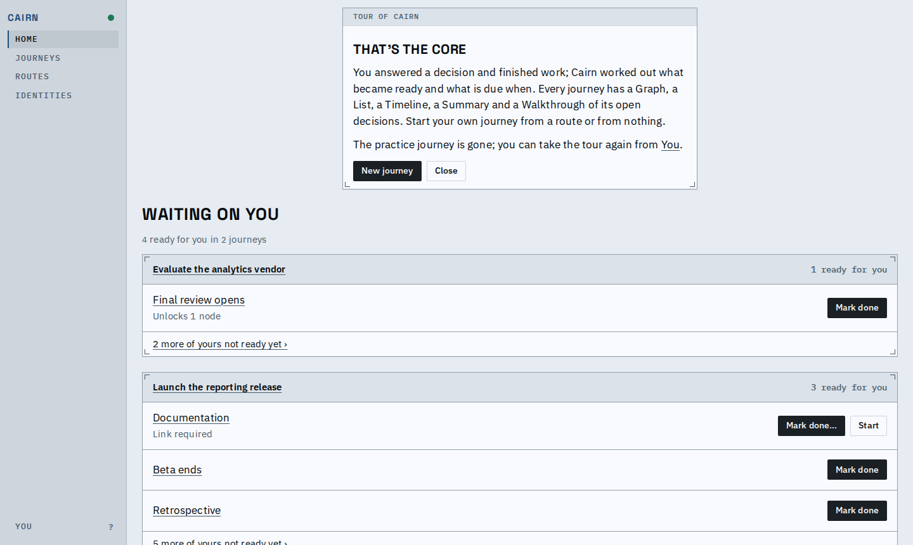

On a phone the band is one compact block. The sheet rises for the answer and drops after it is
saved, and Frontier is reached through Controls.

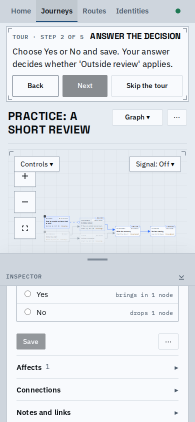
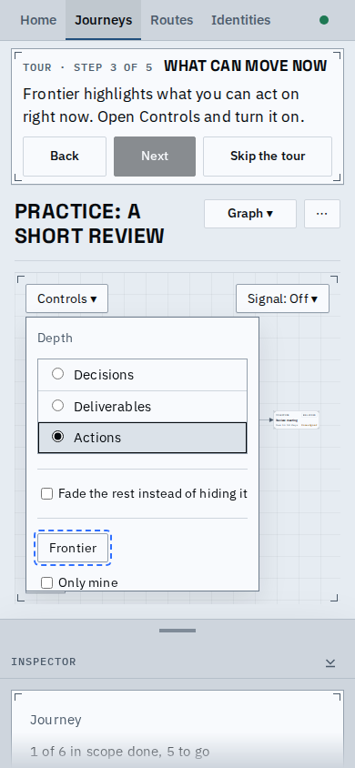
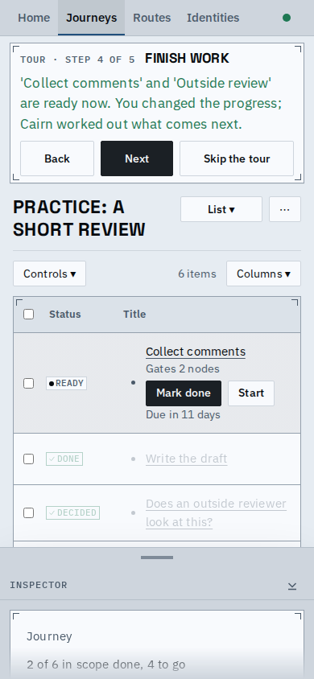
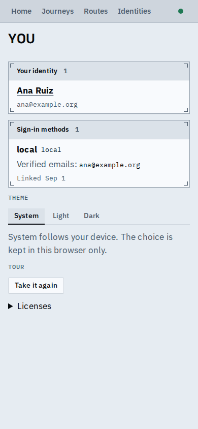

The whole tour: [tour.webm](tour.webm)

Known limits:
- A tour abandoned by closing the tab is offered again on the next visit to Home, to continue or skip.
- On the server the practice journey is visible to everyone in the deployment while it exists.
- On a phone with the sheet half open the graph is small; the selected card is still marked.
