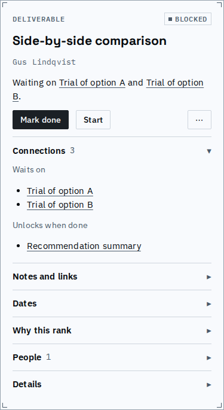
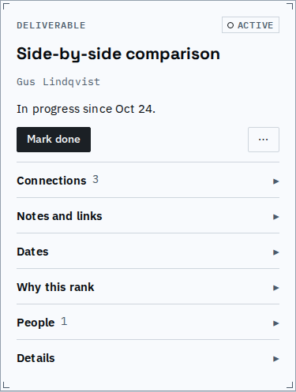
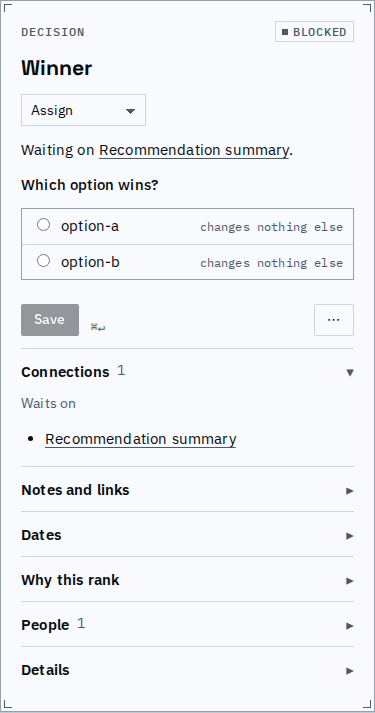
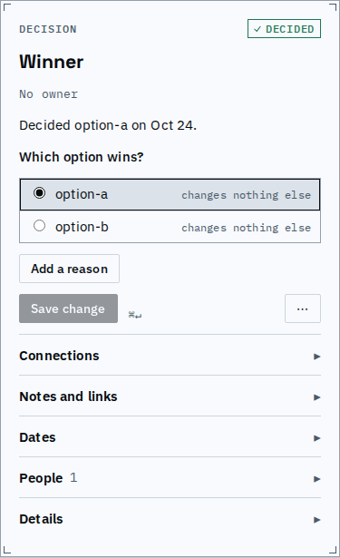
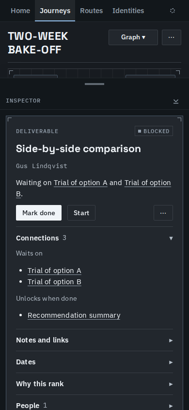

# Work goes ahead with a plain move, and recorded dates never warn

Anyone can start, finish or answer anything, whatever it waits on and whatever its own date,
with the same Start, Mark done or Save as any other move. Nothing asks for a reason and nothing
is labelled early: early work reads like any other active or done work. Shortfalls come only
from the plan ahead, and reopening something finished work relied on still marks that work
stale.

Two-week bake-off, "Side-by-side comparison", which waits on both trials, offers a plain Start:

One click, and it is active, said the way any started work is:

"Winner" waits on the recommendation summary. Its answer form is the usual one:

Save answers it:

On a phone, in the dark theme:

Starting the comparison and answering the decision, each with one plain move:
[plain-moves.webm](plain-moves.webm).

| On a fixture | Before | After |
|---|---|---|
| Bake-off: start the comparison while both trials are open | refused; Start anyway offered | active |
| Bake-off: answer Winner while the summary is open | refused; Answer anyway offered | decided |
| Product launch: mark the go/no-go review done while what it waits on is open | refused; Done anyway offered | done |
| Product launch: code freeze recorded Nov 4, two days after its Nov 2 deadline | short: the code freeze and the launch | short: none |
| Vendor evaluation: the baseline reopened after the findings relied on it | the findings stale | the findings stale |

Evidence is still checked: finishing work that needs a note, an artifact, a ticked checklist
or a breakdown still offers the remedy, or Done anyway with an optional reason.

Known limits:
- A prerequisite reopened before this change carries no record of it, so what relied on it is
  not stale until it is reopened again.
- Dates are days, so work finished on the day its prerequisite was reopened counts as having
  relied on it.
