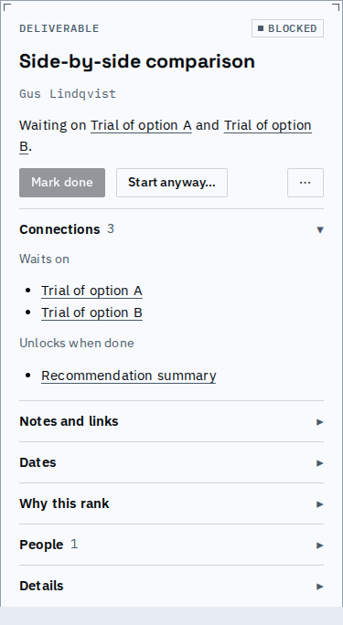
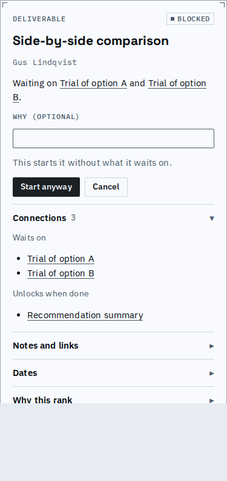
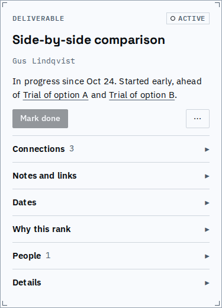
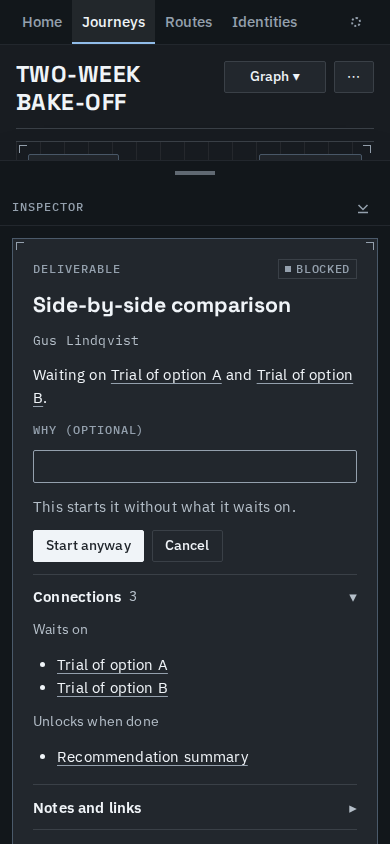

# Starting or finishing early is one choice, with no reason needed

Work that waits on something can be started or finished ahead of it with one deliberate choice: "Start anyway" or "Done anyway". The reason is optional, on these and on every other guard bypass. Early work is never short and has no chip; its sentence says it. A prerequisite reopened after the work finished normally still warns.

Two-week bake-off, "Side-by-side comparison", which waits on both trials:

Start anyway opens one small form. The reason is optional and the button works with the field empty.

The work is now active. Its sentence names what the start went ahead of, and the header carries no "started early" chip.

Done anyway is the same form for finishing ahead (here "Go/no-go review", which waits on two things).

The finished work reads done early, ahead of what it did not wait for; a reason, when one is given, is quoted.

On a phone, in the dark theme:

A short video of starting ahead and finishing ahead, with no reason typed: [early-work.webm](early-work.webm).

| Move on work that waits | Before | After |
|---|---|---|
| Finish ahead, no reason | refused: a reason was required | accepted; done early, by the same days as with a reason |
| Plain start (one click or `transition_node`) | accepted silently, nothing recorded | refused as a bypassable guard failure; "Start anyway" offered |
| Start anyway | not possible | accepted; the engine records what it went ahead of |
| Start normally, then reopen the prerequisite | read "started early" | reads plain "active" |

Known limits:
- Work started ahead before this change carries no record, so it reads plain "active".
- A build from before this change cannot load a journey holding a bypass with no reason.
