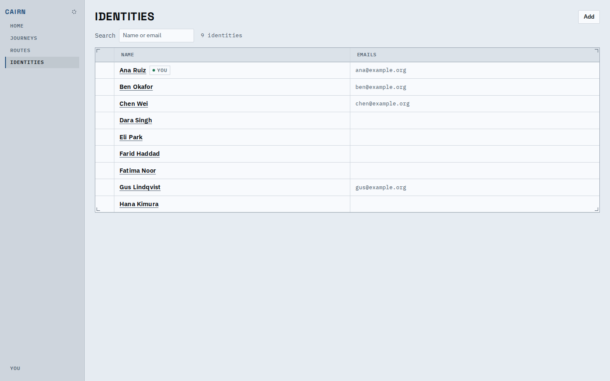
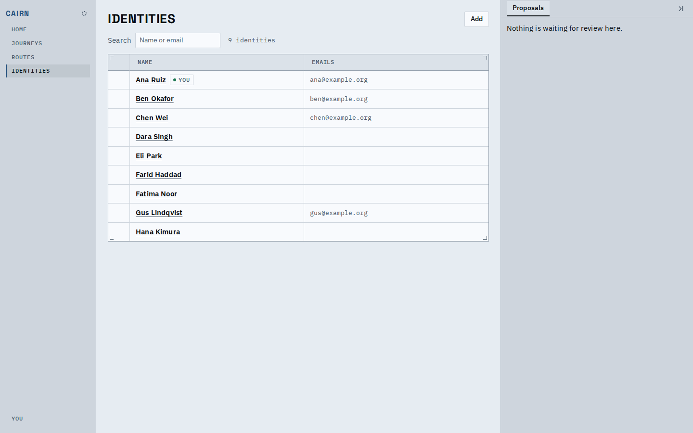

# Fewer notices

Screens no longer carry text that states the obvious, repeats a label, or
guards something the person can undo. Text that prevents a real mistake
(irreversible deletes, stale proposals, offline and sync sentences,
refusals) is unchanged.

## Cut

| Where | Before | After |
|---|---|---|
| Identities index | "People and teams. What each does in a journey is the role it fills there." above the table | table directly under the search |
| Proposals tab, empty | "Nothing is waiting for review here. A proposal stays here from when it is drafted until it is applied or discarded." | first sentence only |
| Journey delete | a "Deleting removes ... for good" line before the button | the button; the confirmation still says it |
| Profile | theme note and "Each holds a verified email of yours..." | removed |
| Home, nothing needs you | an explaining paragraph under the title | title only |

Also removed: the route-authoring "sections save as you change them" line,
the key sheet's "keys never fire in a field" note, the change-by-proposal
helper sentence, the walk's repeated "every decision is made" line, empty
segment-search and empty route-card lines, the lens prompt with no lens,
the tour dock's after-reply explainer and the assistant's "nothing became
stale" line.

## After

The table follows the search row with no intro between.

The empty state is one short sentence.

The cull skill now looks for on-screen text that does not earn its place.
