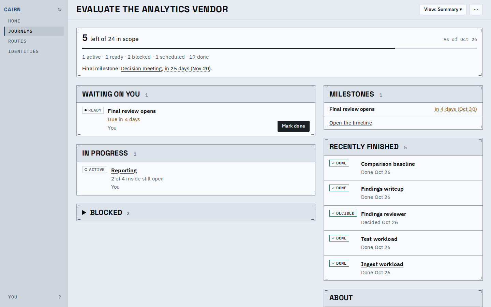
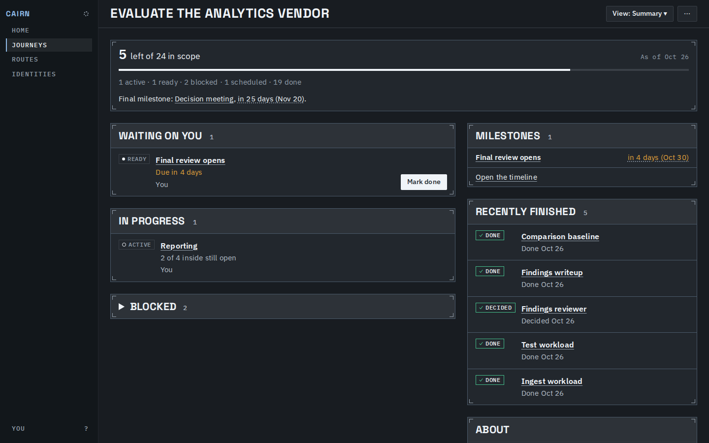
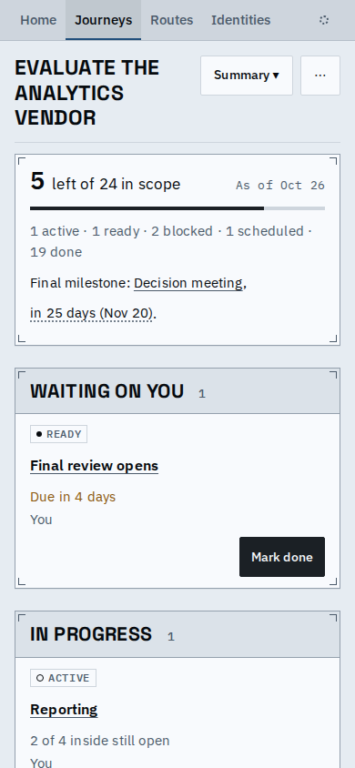
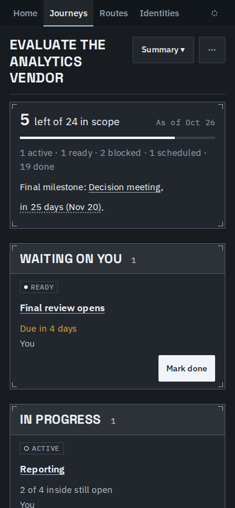

# Proof: `mise run screenshots`

Anyone can now take a picture of every screen state of the app with one command: `mise run screenshots`
writes them to `dist/screenshots/` (or `CAIRN_SCREENSHOTS_DIR`), with a `screenshots.json` manifest
(file, address, state, viewport, theme, url).

## What it captured, from a clean checkout

- 24 addresses (every one the app has), 37 states at desktop width and 34 at phone width.
- Each state at 1440x900 and 390x844 (the phone as a touch screen), in light and dark, on the day the
  fixtures' last patch applies: 142 pictures, about 8 MB, in 14 s once the demo site is built.
- A journey's views come from the views a journey offers and a route's from the views a route offers
  (a route has no Summary or Walkthrough); the rest are chosen states: an inspector open, a popover,
  a card's menu, the Controls menu (phone only), a form, and each proposal address over a drafted proposal.
- Every picture waits for its state's ready sign and passes the containment, internal-key and tooltip
  checks before it is taken.

## One screen, four ways

The journey Summary, as the command wrote it.

| Light | Dark |
|---|---|
|  |  |
|  |  |

## Known limits

- The in-browser host only: sign-in and the assistant talking to a provider are server-only and are left out.
- States are chosen coverage, not every state; the deployment's proposal address shows its gone state, as
  nothing drafts a deployment proposal in the browser host.
