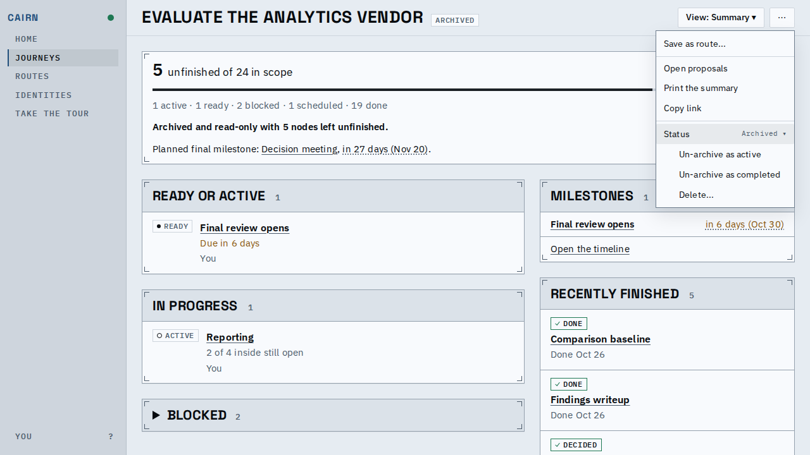

# An archived journey moves straight to active or completed

You can now take an archived journey directly back to active, or to completed, from
the journey header's menu. Before, it could only go to completed, and reopening took a
second move.

The archived journey's `⋯` menu, Status row: "Un-archive as active", "Un-archive as
completed", and Delete.

Every other write to an archived journey is still refused, as before.

## Known limits

- None.
