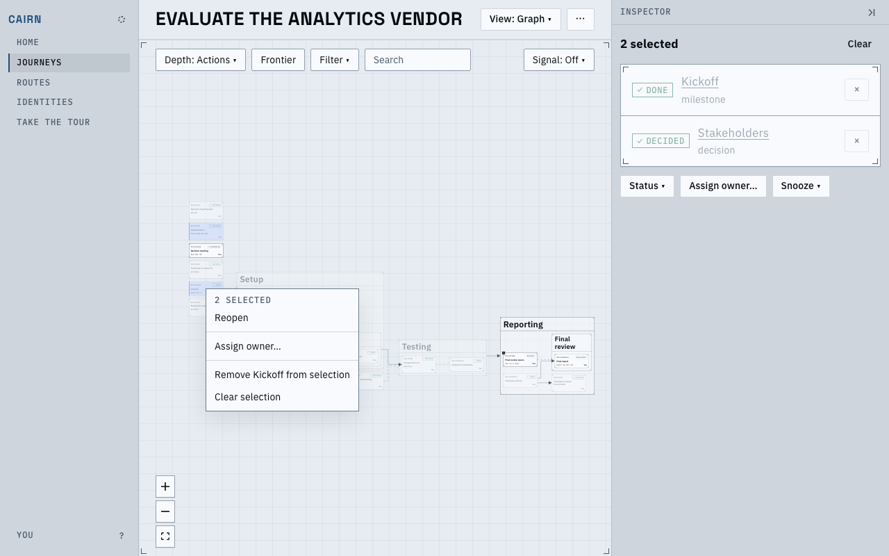
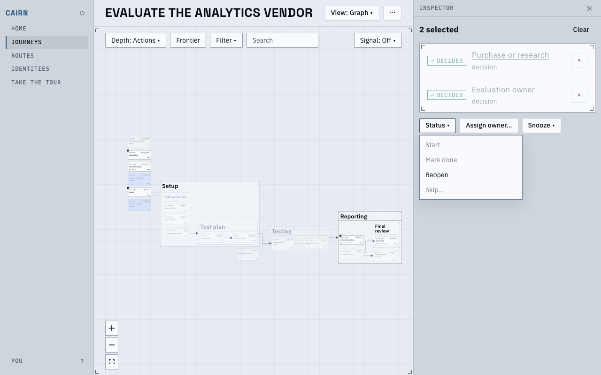
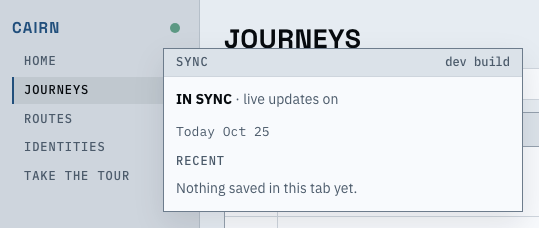

# A selection's menu, Reopen over a selection, and the release in the sync popover

With several cards selected on the graph, a right-click on any of them now opens a menu for
the whole selection, and the inspector's Status menu can reopen them all. A Shift-click on a
card's title adds it to the selection even when the pointer drifts while pressed. The sync
popover's head names the release the server runs.

A right-click on Kickoff while it and Stakeholders are selected. Both are finished, so Status
offers only Reopen, and Snooze is left out.

Two decided decisions selected: Reopen is enabled; Start, Mark done and Skip are disabled with
the reason in their tooltips.

A build without a release tag says `dev build`; a release says its version, such as `v0.13.0`. On the
in-browser demo no server runs, and the head shows none.

<video src="main-flow.webm" controls muted></video>

Shift-click a title while the pointer drifts, right-click a member, Reopen both, then the
inspector's Status menu over two others.

## Known limits

- A card's own actions (Rename, Pin a date) are not in the selection's menu; Remove from
  selection first, or open the card.
