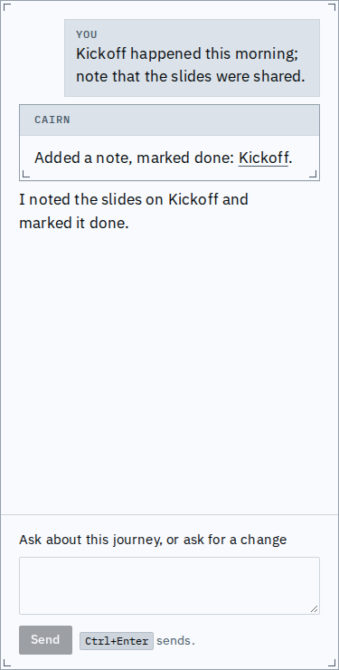
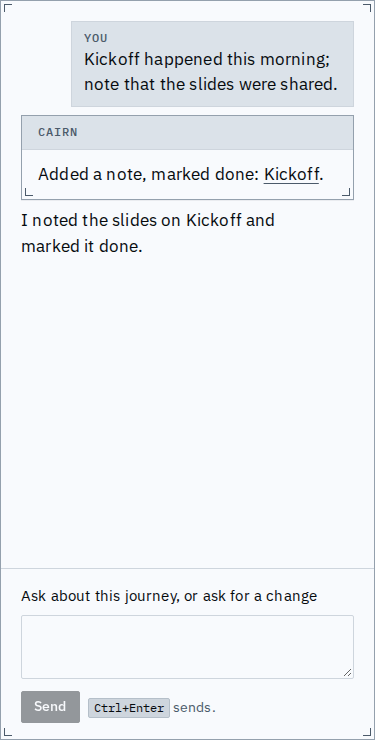

# Proof: the assistant says what a direct change did

A change the in-app assistant applies directly now says what it did in plain words, rather than
the name of the tool it called. A note added with a completion reads "Added a note, marked
done: Kickoff", in the live panel and in the conversation Cairn keeps: one text, shown the same
way, so a new tab reads exactly what the first one did and links the same node.

The live panel: Cairn's card says both parts of the change and links the node it wrote.

A new tab, which holds none of the first tab's turns: the same card from the kept conversation.
Anything the change made stale, short of time, overdue or undecided is named the same way.

[The flow, from the message to the new tab](main-flow.webm)

## What changed

| | Before | After |
|---|---|---|
| Live panel, a note with a completion | "apply patch" | "Added a note, marked done: Kickoff." |
| Kept report | "Applied `apply_patch` as patch `p_...`: journey j_... is at revision 2, with 0 new consequence(s)." | the live card's text |

Each kind of change is said once, in the order it first comes. A node the journey has since
removed reads "an item that was removed", and a node of another journey links there.

## Known limits

- A tab open across the deploy shows its earlier turns as Cairn's kept text, not as cards.
- A node of another journey is linked without its title.
