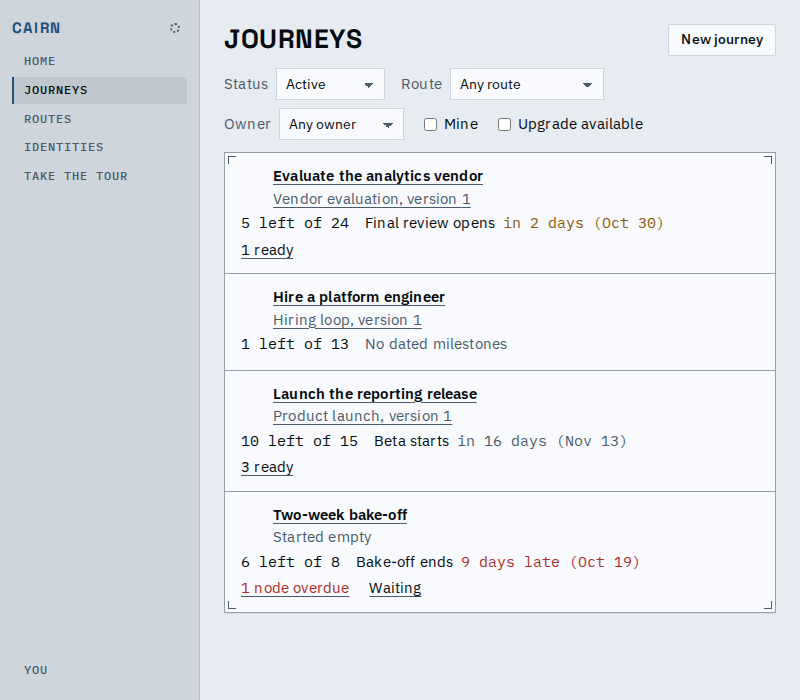
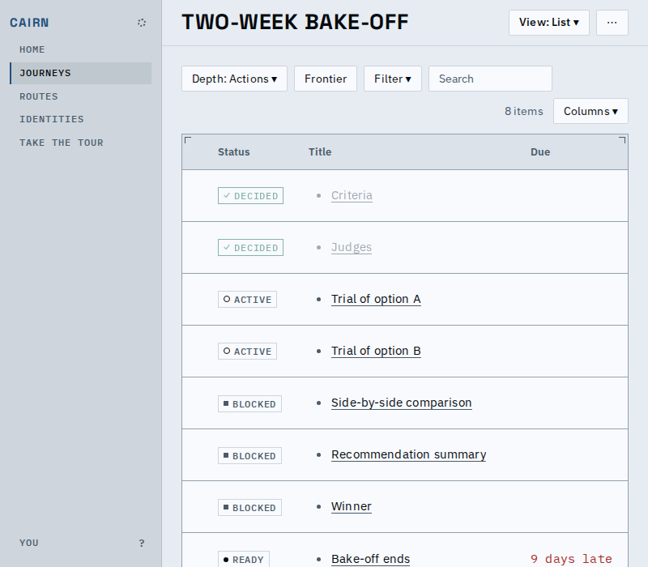
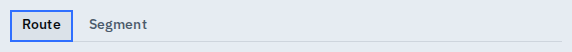

# Proof: screen structure fixes

The structure checks that now run over every screen state turned up real layout and
colour problems, fixed in the same work. What a person sees differently:

## Index tables stack below 1100px

Under 1100px wide, where the inspector is a sheet and the columns no longer fit beside the
rail, each row of an index is a block (title, route, progress, next date, flags) instead
of a cramped table.

*The journeys index at 800px: every row reads top to bottom, nothing runs past the edge.*

## Darker success and error colours

The success and error colours are darker so their text holds the contrast floor on the
surfaces it sits on.

*Decided rows keep a readable green chip while the finished row text stays muted; the late
date is the error red.*

## Focus rings

Segmented buttons show the same 2px ring as every other control when the keyboard reaches
them, and so does a line of the graph (one Tab walk per screen checks both).

*Keyboard focus on a segmented control.*

## Known limits

- The width sweep runs in the light theme only; dark is held to the same layout by the
  light-versus-dark comparison, not by its own sweep.
- The graph line's ring is checked by the Tab walk but is not pictured: a line is a hairline
  at the fitted zoom, so a still shows little.
- The sync mark's conflict glyph, drawn in the darker error colour, is not pictured; it
  needs a conflicting write that the demo host does not produce.
